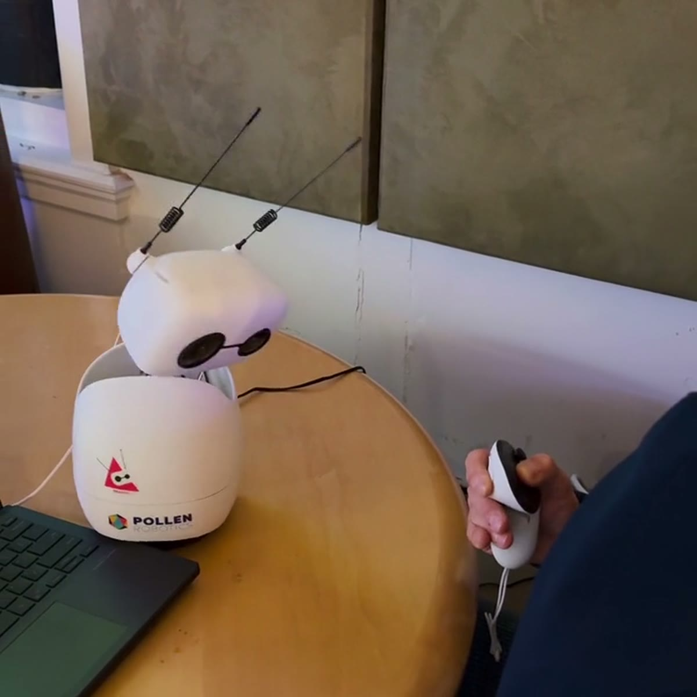
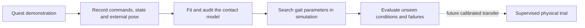

# Can a tabletop robot learn to walk?

Reachy Mini has an expressive moving head, but no legs. This project investigates whether shifting that head can rock the body onto an edge, recover balance, turn, and produce repeatable progress across a table.

The starting observation was controller-driven rocking on a physical robot. The current research combines **Quest demonstration capture, a calibrated-recording workflow, and MuJoCo experiments with learned gait parameters and feedback**.

[](https://vimeo.com/kadiru/demo-reachy-reach#t=0s&end=7s)

*Physical teleoperation footage. Apparent progress is visible; this clip does not measure speed or demonstrate an autonomous learned gait. [Frame-by-frame observations](docs/VIMEO_OBSERVATIONS_2026-11-18.md).*

This standalone locomotion research is separate from [Emcee / Sidekick](https://github.com/kadiru/Emcee), the mobile-host prototype in which Reachy Mini rides on temi.

**Watch the simulation:** [three-minute trained-skills reel](media/simulation/trained-skills-reel.mp4) · [moving-table feedback comparison](media/simulation/moving-table-feedback.mp4)

## What the experiments show

| Selected simulation | Result | Boundary |
| --- | --- | --- |
| Moving-table feedback | Holds the downhill edge through a 10° tilt and return in **3/3**; level-table command replay loses it at **1.04°** in all three | Model-specific comparison. [Measurements](docs/MOVING_PLATFORM_BALANCE.md) |
| Sustained penguin gait | **633.4 mm** over **20 step pairs**, **3.88 mm/s**, no falls in the saved run | Frozen four-pair qualification **11/16**; robustness incomplete. [Protocol](docs/SUSTAINED_PENGUIN_2026-11-20.md) |
| Slick-floor quarter turn | **95/95** matched trials; **7/10** final held-out checks | Training-condition success is not generalization. [Results](docs/SLICK_QUARTER_TURN.md) |

These are separate experiments, not one controller passing a combined suite. Physical transfer of the learned skills remains unverified. Full successes, failures, earlier actuator assumptions and timestep sensitivity remain in the [experiment index](docs/EXPERIMENT_INDEX.md). [Measured training energy and cost](docs/TRAINING_COMPUTE.md)

<a name="original-first-milestone"></a>

<a name="what-is-implemented"></a>

## The central idea



The implemented learning uses parameter search and bounded feedback. Residual RL is a roadmap item. The project also builds recording, displacement analysis, replay planning and guarded command infrastructure; synthetic/mock tests of that infrastructure are not robot commissioning.

<a name="start-here"></a>

<a name="run-locally"></a>

## Inspect or try it

Start with the [learning roadmap](docs/LEARNING_ROADMAP.md), [first recording session](docs/FIRST_RECORDING_SESSION.md) and [CPU contact probe](docs/CONTACT_PROBE.md). Source is under [`src/reachy_locomotion/`](src/reachy_locomotion/).

The smallest check needs Python 3.9–3.12 and no robot:

```sh
PYTHONPATH=src python3 -m reachy_locomotion validate data/synthetic/known-answer.jsonl
PYTHONPATH=src python3 -m reachy_locomotion analyze data/synthetic/known-answer.jsonl
```

The fixture deliberately invents 10 mm travel per cycle. It tests the recording and analysis contract, not locomotion performance. Simulation needs the additional dependencies and pinned upstream model documented in the [setup guide](docs/EXPERIMENT_INDEX.md#start-here).

<a name="evidence-and-next-work"></a>

## Next milestone

Capture an instrumented physical trial with synchronized command/state and external base-pose measurements, fit the contact and motor assumptions, then compare a supervised replay against the simulation. Preserve the robot's installed SDK and complete the documented guardian and stop checks before execution.

[Full experiment index](docs/EXPERIMENT_INDEX.md) · [Motor assumptions](docs/MOTOR_LIMITS.md) · [Current project status](STATUS.md)
