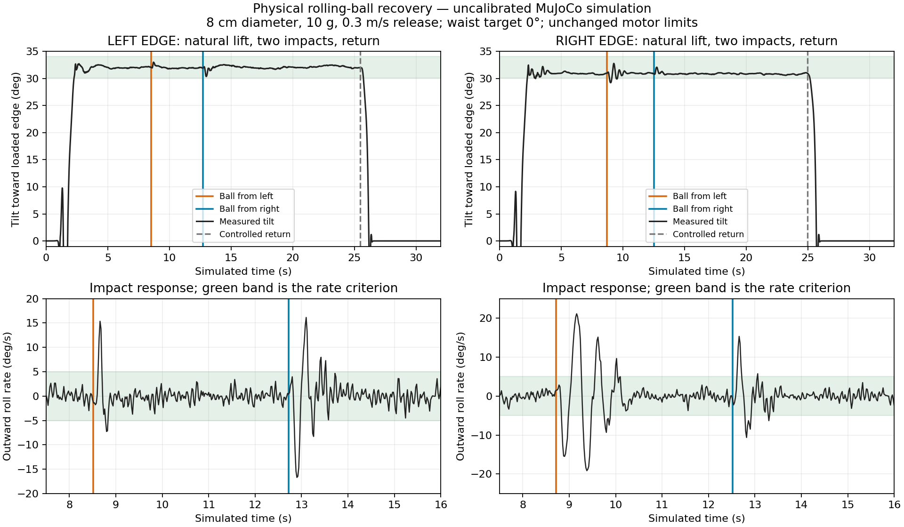

# Rolling-ball edge recovery — November 20, 2026

Two complete nominal simulations now **start flat, lift onto a side edge,
withstand a rolling ball from each direction, regain balance and return flat**.
All four balls contact and bounce away from the robot. These are gentle,
selected demonstrations; the frozen impact sensitivity suite passes only
**7/28**, and natural front/back launch remains unresolved.

Frozen configuration: `configs/balance-recovery-experimental.json`.
The earlier balance and walking policies are preserved. This work uses local
system identification and feedback-parameter search, not neural RL.

## What the video demonstrates

[Video, real-time playback](../media/simulation/ball-balance-recovery-2026-11-20.mp4):
two independent 32-second simulations, each shown through 29.04 seconds so
both the launch and final return are visible. The second clip starts a new
right-edge trial; it is not a continuous left-to-right transfer. Frames replay
recorded MuJoCo positions, including the balls, rather than desired animation.

Each ball has an **8 cm diameter and 10 g mass**, released with **0.3 m/s**
horizontal speed and the matching rolling angular velocity, 0.3 m from the
base center. The orange ball arrives from the robot's left; blue from its
right. Releases occur at 8 and 12 seconds. Positions are relative to the
base's heading at release, not the viewer's left/right. After release,
gravity, friction and collision integration determine the ball motion.

| Measured result | Left-edge sequence | Right-edge sequence |
| --- | ---: | ---: |
| Natural flat start, two impacts, return flat | Pass | Pass |
| Recovery after ball from left | 0.325 s | 1.339 s |
| Recovery after ball from right | 0.815 s | 0.799 s |
| Largest impact attitude change from pre-impact mean | 1.59° | 2.02° |
| Longest continuous strict edge hold | 12.06 s | 11.78 s |
| Controlled return begins | 25.46 s | 24.96 s |
| Peak physical tilt | 33.02° | 32.79° |
| Peak head motor torque | 0.299 Nm | 0.287 Nm |
| Peak waist torque | 0.0507 Nm | 0.0488 Nm |
| Minimum actual joint-limit margin | 0.0479 rad | 0.0548 rad |

Recovery time is the beginning of the first **continuous 0.5-second qualified
interval** after impact, confirmed afterward. It is not a claim of exact
return to the pre-impact pose. Normal contact impulses are 0.00840–0.00903 N·s;
these are sums of contact-normal magnitudes, not net horizontal impulses.
The measured disturbances are modest, not arbitrary pushes near the fall limit.



## Controller and physical environment

The existing independently trained side launch recipes feed the local affine
edge controller. New parameters tune capture/hold gain transition, task-space
command rate and attitude/rate filtering. The controller receives delayed noisy
attitude and body-local gyro, plus ideal relative head pose. A causal
complementary estimate integrates gyro rates and corrects toward noisy attitude.
It uses faster correction during launch/capture. An optional model observer
was tried unsuccessfully and remains disabled in the selected policy.

Selected left/right sensing is 0.05° attitude noise, 0.1°/s gyro noise,
50 Hz control and 20 ms observation delay. Simulated gyro readings are averaged
at **1 kHz over each control interval**, then noisy feedback is delayed. This
averaging reduced contact-rate aliasing enough to recover noisy nominal holds.
**It is an uncalibrated assumption and differs from the pinned stock SDK's
50 Hz IMU readout.** Reachy Mini Wireless has an IMU, but this processing is
not automatically provided by its current driver. The pinned upstream
[robot backend](https://github.com/pollen-robotics/reachy_mini/blob/a9a2a42adcc1abc7d9c90d390889bbebf930c96c/src/reachy_mini/daemon/backend/robot/backend.py#L535)
documents its 50 Hz integration step. Sensor timing, bandwidth, noise and
head-pose estimation must be matched to hardware before transfer.

The controller has no ball position, launch schedule, impact detector,
contact force or COM input. Contact truth is only used to score outcomes.
Continuous sensed stability triggers the return: head motion toward the
loaded edge produces an inward body reaction, followed by a neutral target
once body tilt drops below 20°. Commands still pass the original IK, servo
and actual joint guards. An emergency-return variant was tested but failed
outward wedging impacts and is not enabled in the selected demonstrations.

Balls are separate free bodies, appended after robot mass modifications.
Each ball's state is initialized once at release. No robot pose is reset,
no direct robot force is applied, and there is no hidden support. The ball
contact law uses MuJoCo's direct stiffness/damping format, `solref="-25000 -35"`,
with priority 1, six-dimensional contact and friction `0.25 0.001 0.00002`.
Negative `solref` entries specify direct stiffness/damping; they are not a
measured coefficient of restitution. See the official
[MuJoCo restitution documentation](https://mujoco.readthedocs.io/en/3.3.3/modeling.html#restitution).
The chosen compliant bouncing material is a modeling hypothesis. Ball contact
priority affects ball collisions; it does not replace the robot-floor law.

The robot mass distribution, physical motor torque/speed bounds and joint
limits are unchanged. The same 10.7 rad/s target speed, 360 rad/s² target
acceleration and 25 Hz target filter remain in force. The new controller's
task-space rate limits are additional restrictions, not new motor specifications.
The waist stays at a constant zero target under bounded servo torque, with
about ±1.06° maximum deflection, not a welded joint. Peak head torque remains
below 0.416 Nm and closure error below 0.031 mm in the two recordings.
The 35° tilt, IK, actual joint and robot nonfoot-floor guards are unchanged.
Ball-floor contacts are deliberately excluded from the *robot* fall detector.
Motor/contact assumptions remain uncalibrated; no robot or shared GPU was used.

## Frozen qualification and failures

The selected policy was frozen before 38 qualification trials, with no
parameter retuning afterward. A strict hold requires the requested edge to
support the body, signed tilt within 2° of target, tilt rate at most 5°/s
and cross-axis tilt at most 5°. An impact pass additionally requires stable
balance before the hit, actual robot contact, a separated rebound, recovery
within three seconds, and continued stable final hold or a qualified return.
Returning flat alone is not a successful edge recovery.

| Impact condition (14 per edge) | Left | Right |
| --- | --- | --- |
| Nominal, ball from left | Pass | Pass |
| Nominal, ball from right | Pass | Pass |
| 0.1 ms physics, ball from either side (two each) | Both fail | Both fail |
| 0.25 ms physics, ball from either side (two each) | Both fail | Both fail |
| Fresh sensor seed | Pass | Pass |
| Attitude noise 0.1° | Pass | Actual joint guard |
| Gyro noise 0.3°/s | 35° guard | 35° guard |
| Observation delay 40 ms | 35° guard | 35° guard |
| Robot mass −5% / +5% (two each) | No qualified hold | No qualified hold |
| Ball 20 g at 0.5 m/s | Actual joint guard | Actual joint guard |
| Ball diameter 6 cm | 35° guard | 35° guard |

Total: **left 4/14, right 3/14**. Timesteps fail during natural launch before
the impact, so these do not isolate the impact controller's numerical
sensitivity. They still invalidate the complete behavior. Smaller balls can
wedge under the raised rim, causing much larger reactions than their release
momentum alone suggests. The stronger and smaller failures remain recorded.
This suite does not establish timestep convergence, robust disturbance
rejection or a hardware-safe operating envelope.

Eight separate hold/return checks pass **6/8**. Natural left/right pass at
0.125 ms and fail at 0.25 ms. Front/back pass at both timesteps from explicitly
artificial 32.1° resets. The front uses noisy sensing; the back retains the
older noiseless-angle baseline because new noisy back policies failed.

The moving-front curriculum starts artificially at 31° pitch and 10°/s
outward rate, with free-base translation initialized so the supporting rim is
stationary. After that initial state, there is no imposed motion. An adaptive
task-space command-rate limit catches, holds and returns at 0.25 ms; at
0.125 ms it returns safely flat but its 4.42-second strict hold misses the
4.9-second acceptance threshold. Thus **1/2 moving capture/return checks pass**.
Another **24 natural front-launch attempts all fail**, longest strict hold
0.06 s. Natural front/back launch is still unsolved; an artificial moving
start is not evidence of a learned launch.

## Evidence and reproduction

Full retained reports are `experiments/reports/motor-training-ball-*.json`.
Key files are `...-bilateral-2026-11-20.json` for the two demonstrations,
`...-qualification-2026-11-20.json` for all 38 frozen checks,
`...-front-natural-2026-11-20.json` for failed natural front launches,
and `...-artifacts-2026-11-20.json` for hashes, replay equality and pass counts.
The qualification report embeds every job configuration and source hashes.
Earlier development reports preserve failed observer, gain, sensor, capture,
return, emergency-return and ball-size searches. Earlier report versions may
use the original in-contact rebound-speed metric; final demonstrations and
qualification require outgoing speed after at least 5 ms separation.

**140 repository tests pass**, including rolling velocity and collisions from
both sides, preserving robot state at ball launch, no repeated launch,
missed/unbalanced impacts, unchanged robot mass and robot-only floor guards,
stationary-rim initialization, delayed gyro input and continuous return timing.
The final saved-policy CLI replay reproduces every recorded physical frame,
controller trace and curriculum result of the left demonstration exactly.

Run from the project root with the existing project environment and pinned
upstream assets. Outputs refuse overwrites:

```sh
.venv/bin/python experiments/run_balance_curriculum.py configs/balance-recovery-experimental.json --edge left --mode impacts --seconds 32 --record --output experiments/generated/left-ball-replay.json
.venv/bin/python experiments/run_balance_curriculum.py configs/balance-recovery-experimental.json --edge right --mode impacts --seconds 32 --record --output experiments/generated/right-ball-replay.json
.venv/bin/python experiments/render_sway.py experiments/generated/left-ball-replay.json --output experiments/generated/left-ball-replay.mp4 --slowdown 1 --diagnostics --until 29 --title 'LEFT EDGE - BALL IMPACT RECOVERY'
.venv/bin/python experiments/run_balance_curriculum.py configs/balance-recovery-experimental.json --edge front --mode cycle --raised-start-deg 32.1 --seconds 18 --output experiments/generated/front-return-replay.json
.venv/bin/python experiments/run_balance_curriculum.py configs/balance-recovery-experimental.json --edge front --capture-policy --mode cycle --raised-start-deg 31 --outward-rate-deg-s 10 --timestep 0.00025 --seconds 18 --output experiments/generated/front-moving-replay.json
.venv/bin/python -m unittest discover -s tests -v
```

Use `--edge back --raised-start-deg 32.1` for the back raised-start cycle.
Omitting the reset tests an unqualified natural fore-aft launch. To replay
the complete frozen qualification without overwriting the one recorded run:

```sh
.venv/bin/python - <<'PY'
import json
from pathlib import Path
r = json.loads(Path('experiments/reports/motor-training-ball-qualification-2026-11-20.json').read_text())
for job in r['jobs']:
    job.pop('record', None)
with Path('experiments/generated/ball-qualification-replay-jobs.json').open('x') as f:
    json.dump(r['jobs'], f)
PY
.venv/bin/python experiments/train_balance_robustness.py --jobs experiments/generated/ball-qualification-replay-jobs.json --output experiments/generated/ball-qualification-replay.json --workers 4
```

Next: repair the timestep-sensitive launch/contact response, match the sensor
pipeline to the real IMU, and train the failing disturbances before reserving
a fresh qualification split. Stronger impacts or walking composition should
not obscure the current failures.
