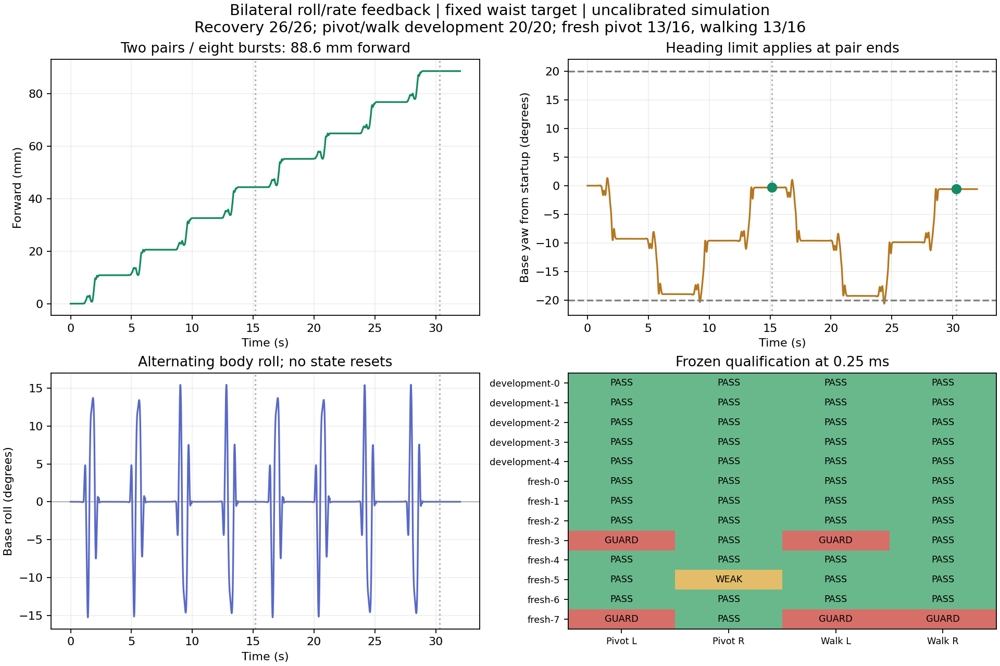

# Bilateral recovery, edge pivots and penguin composition

The November 19 follow-up adds delayed roll and roll-rate feedback, trains both
sides, and composes the learned motions without resetting the robot's physical
state. This is local CPU MuJoCo simulation, not hardware execution or a fitted
digital twin. It preserves the previous rapid and large-rocking walking policies.

## Controller and learning method

`balance.py` predicts base roll from delayed angle and a filtered finite-difference
rate. Separate angular and lateral head corrections are bounded before the same
checked IK used by the simulator. Unreachable commands are projected inward
toward a neutral head pose; this does not enlarge the workspace or suppress the
actual joint/closed-chain guards. The recovery policy returns toward neutral.
The pivot policies catch a signed rocking phase, add a 40° requested head-yaw
stroke, hold through the supported phase, then return. Actual head motion is
limited by IK projection, software profiles and the motor model.

Learning uses parameter sweeps and a seeded cross-entropy launch search, not a
neural RL policy. The launch search varies sway, lateral travel, frequency,
preload, posture and timing. Failures, including falls/guards, weak turning and
excessive drift, are retained. Merely settling upright does not pass the pivot
or walking gates.

`penguin.py` composes the primitives using observed progress. Each burst must
settle in roll/rate and physically return its forward head offset before the
next one. The controller repeats the current side until its delayed base heading
reaches a 15° half-cycle goal (2° tolerance), then alternates toward startup
heading. At most three bursts are allowed per half. If a settled burst produces
less than 3° of signed progress, subsequent bursts use a second learned launch.
This choice uses measured heading, never the hidden stress-model parameters.
There is no pose, velocity, contact or motor-state reset between bursts.

The nominal demonstration uses **two bursts on one side, then two on the other**
per complete pair. A reported 44 mm pair is therefore four bursts, not one giant
step. The settling pauses trade speed for reproducibility; the preserved fast
headshake gait remains much faster.

## Physical and sensing assumptions

The waist holds a **constant zero target** through the bounded motor model. It is
not welded and not unpowered: its angle can deflect and its servo supplies
reaction torque. Reports disclose that angle, peak holding torque and work.
Head-only commands do not imply zero waist torque.

All existing [motor assumptions and manufacturer sources](MOTOR_LIMITS.md) remain
unchanged: nominal 5 V hypothesis, torque/speed/PWM envelopes, hardware joint
limits, 1.475 kg mass correction, and the 10.7 rad/s / 360 rad/s² / 25 Hz software
command profile. These profile settings and bus voltage are not measured on the
user's battery-powered robot. New balance/walking trials use the 35° tilt guard,
plus the unchanged joint-limit, closed-chain, numerical and nonfoot-contact
guards. A guard stop is an incomplete failure even without a physical fall.

Control runs at 50 Hz. Nominal roll and heading are delayed 20 ms; validation
varies roll delay to 40 ms and adds 0.05–0.15° roll noise. Heading has 20 ms delay
and 0.1° noise. A hardware estimator of base roll/rate and startup-relative floor
heading remains to be implemented/calibrated. Relative head-yaw braking and
other alternatives were explored but are not selected in the frozen policy.

## Acceptance gates and split

- Recovery: completed and settled for the last 0.6 s, peak roll ≥6°, tilt <3°,
  angular speed <0.2 rad/s, translation speed <0.02 m/s, supported by >0.5 N.
- Edge pivot: recovery plus ≥0.08 s edge support, ≥5° signed final floor-base
  turn and ≥5° signed turn during edge support, center drift ≤56 mm, sampled
  edge contact material-point slip ≤15 mm. Torso twist alone does not pass.
- Walking: all requested halves complete and finally settle, average full-pair
  progress ≥15 mm, both roll directions ≥6°, every pair moves forward, and
  startup-relative heading within ±20° at each pair end. Larger intermediate
  torso/base swings are allowed.

Development covers nominal plus four prior failing friction/motor/mass models,
on both sides. Frozen recovery passes **26/26** at 0.25 ms: ten development and
sixteen fresh noisy/delayed-sensor trials, seed 2026111963. Earlier qualification
seeds 2026111961/62 each exposed a guard failure and became development evidence.
The `recovery-conservative` report duplicates an earlier replay and is not an
independent success.

The composed policy passes **20/20 development checks** at both 0.5 and 0.25 ms:
five models × both initial sides × isolated pivot/full-pair walking. Separate
qualification uses eight new model draws, both sides, pivot and walking modes,
with frozen seed 2026111971 and 0.25 ms physics. Two-sided nominal checks also
use 0.125 ms. Results: **13/16 unseen pivot passes and 13/16 unseen walking passes**.
Fresh-3 left and fresh-7 left reach the 35° guard; fresh-7 right walking reaches
it during its later left half. Fresh-5 right pivot settles but turns only 4.73°
while edge-supported, below the unchanged 5° gate. The five guard trial records
include repeated prefix failures across modes, not five independent conditions.
All four nominal 0.125 ms checks pass. Thus the selected controller passes the
original stress suite but does **not** yet pass the broader unseen suite.

An emergency neutral-return override was then screened on the exposed failures.
Although it saves some single bursts, the full sequence still fails; another
case exceeds an actual joint limit and another misses its turning goal. The
selected/video policy does not enable this override. Those promoted cases are
now development data, not available for a future independent qualification.

The first aborted emergency screen is explicitly incomplete. Historical compact
reports may retain the old constant `roll_sensor_delay_s` metadata; the actual
per-trial delay is in each frozen job's feedback configuration. The simulator
now reports that configuration correctly; no physics or acceptance result was
changed by the metadata fix.

[Watch the real-time video](../media/simulation/bilateral-penguin-2026-11-19.mp4).



## Demonstration

At 0.25 ms, the saved two-pair run advances **88.64 mm** with **44.32 mm per pair**,
minimum bilateral peak roll **15.27°**, and pair-end headings **−0.32° / −0.60°**.
Eight bursts finish at 30.30 s; the recording continues to 32 s. Progress speed
is **2.93 mm/s** through the last completed burst, or **2.77 mm/s** including the
final rest. Do not compare this value to a short peak speed or call it faster
than the earlier gait. Rendering reads saved qpos states, with no replayed or
invented motion, at 1× speed. The full 42.12 s video contains two five-second
recovery trials followed by the 32 s walking trial. These chapters are separate
initializations; the walking chapter itself has no resets. At 0.125 ms the same
two-pair policy advances 89.16 mm (0.59% difference), with 1.03° maximum pair-end
heading error. Peak waist torque in the shown gait is 0.0780 Nm and waist angle
deflects −2.48…+2.44°. **100 repository tests pass**.

## Reproduce

From the project directory, using the pinned upstream model and local `.venv`:

```sh
.venv/bin/python experiments/run_balance.py configs/balance-recovery-trained.json --side -1 --record --output experiments/generated/my-left-recovery.json
.venv/bin/python experiments/run_balance.py configs/balance-recovery-trained.json --side 1 --record --output experiments/generated/my-right-recovery.json
.venv/bin/python experiments/run_penguin.py configs/penguin-feedback-experimental.json --cycles 2 --seconds 32 --record experiments/generated/my-penguin.json --output experiments/generated/my-penguin-summary.json
.venv/bin/python experiments/render_sway.py experiments/generated/my-penguin.json --output experiments/generated/my-penguin.mp4 --slowdown 1 --title 'BILATERAL PENGUIN STEPS' --diagnostics --frame-path --follow-front
.venv/bin/python experiments/qualify_policy_bank.py --output experiments/generated/my-qualification.json
.venv/bin/python -m unittest discover -s tests -v
```

Generated trajectories are ignored; compact reports, recipes and final media
are versioned. Scripts refuse to overwrite previous result files. All training
was confined to this personal Reachy project on the Mac; no shared GPU job,
robot, Nimbus/EY project or motor configuration was touched.
