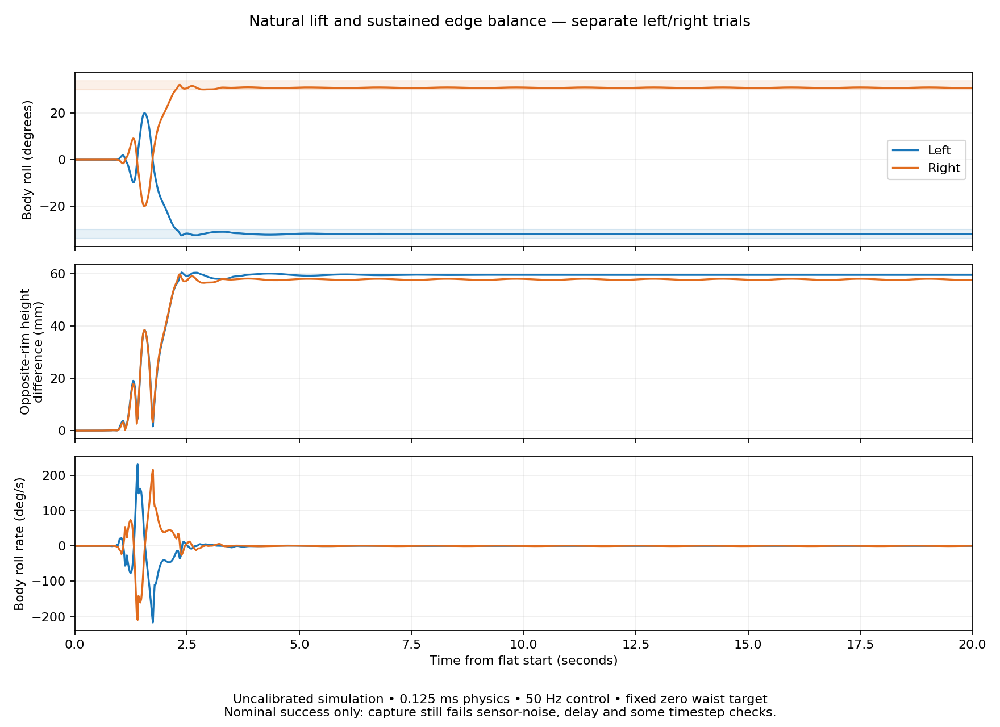

# Natural lift, fall arrest and sustained edge balance

The new experimental policies lift from flat, arrest outward rocking and hold
on either base edge. Both complete a 60-second nominal simulation with the
waist target fixed at zero and the existing motor limits. The continuous
qualified holds last **57.36 seconds on the left and 56.74 seconds on the
right**. This is a separate skill; earlier walking policies are unchanged.

**Capture is not robust yet.** Small sensor noise and extra delay fail, and
the left launch fails the alternative timestep checks. These are successful
nominal simulations, not a calibrated or hardware-ready controller.

[Watch both natural launches at real speed](../media/simulation/edge-balance-bilateral-2026-11-20.mp4).
The video contains the first 20 seconds of two independent trials, with a
fresh flat start for each side. It renders saved physical states, not an
animation of intended motion. Its 1,002 frames at 25 fps last 40.08 seconds;
the two inclusive final frames account for the extra 0.08 seconds.

## Recorded behavior

| Measurement | Left edge | Right edge |
| --- | ---: | ---: |
| Capture command starts | 2.22 s | 2.20 s |
| Continuous qualified hold in the 20 s recording | 17.36 s | 16.74 s |
| Continuous qualified hold in the 60 s extension | 57.36 s | 56.74 s |
| Roll during the recording's final 5 s | −32.061…−32.060° | +30.871…+31.172° |
| Peak total body tilt | 32.89° | 32.47° |
| Peak opposite-rim height difference | 60.38 mm | 59.76 mm |
| Mean final opposite-rim height difference | 59.45 mm | 57.70 mm |
| Smallest actual joint-limit margin | 0.0479 rad | 0.0548 rad |
| Maximum closed-chain error | 0.0288 mm | 0.0301 mm |
| Peak waist holding torque | 0.0506 Nm | 0.0488 Nm |

The height measurement is the difference between opposite base rim points,
not flight. The right hold retains a small approximately 0.3° roll oscillation;
it is not perfectly motionless. Both recordings and both minute-long extensions
complete without a tilt, joint, closure, numerical or body-contact guard stop.

A hold requires one-edge support, signed roll within 2° of the 32.1° target,
absolute roll rate at most 5°/s and absolute pitch at most 5°. Success requires
all of those conditions throughout the final five seconds **and full physical
completion**. The longest continuous hold counts actual intervals between
samples, not the number of samples. A flat recovery, brief turning point,
wrong-side lean or terminated trial does not pass.



## What was learned

An anchored diagnostic first mapped the whole-body center of mass for several
head poses. The neutral model's static edge equilibrium is about 32.09°.
Moving the head changes that equilibrium. During the selected holds, the
horizontal COM projection approaches the loaded contact; the controller does
not receive that diagnostic. This explains “near tipping” more precisely than
treating the retained 35° guard as a physical tipping angle. Dynamic
recoverability also depends on velocity and head state.

Initial direct searches using only body roll/pitch and their rates did not
produce a sustained hold. The successful hold controller additionally observes
head roll, pitch and horizontal position, estimates their rates, and uses a
learned local dynamics model. A quadratic regulator computes head targets;
a model prediction accounts for the known sensor age using past commands.
This is local dynamics identification and parameter-trained feedback, **not a
neural reinforcement-learning policy**.

Identification used 64 explicitly artificial tilted starts with small random
head commands. The first 48 episodes supplied 807 filtered transitions for
the fit; the remaining 16 were reserved for one-step prediction checks.
The full observation/action dataset and fitting metadata are retained in
`experiments/reports/motor-training-edge-identification-2026-11-20.json`.
The fitted model has 20 state variables: six measured positions/angles,
their finite-difference rates and two previous four-component commands.
Commands are head roll, pitch, forward translation and lateral translation.

Those artificial starts demonstrate only the isolated hold skill. A separate
parameter search trained natural launches from flat on each side. The selected
launches use lateral pumping, a delayed roll-triggered counter-motion and a
forward-head return before handing over to the regulator. The first launch
catch interpolates the threshold crossing using delayed roll/rate. That reduces
one source of 50 Hz event quantization, but does not resolve the observed
sensitivity. Mirroring a successful launch was insufficient; the final two
launch recipes are different. All exploratory failures remain in the reports.

The selected recordings have `natural_upright_start: true`,
`diagnostic_initial_roll_deg: null` and `external_forces_applied: false`.
After the existing excluded initialization/settling, no root pose or velocity
is written and no external push is applied. Only bounded motor commands move
the robot. COM, contact forces and slip are evaluation diagnostics, obtained
through the [MuJoCo API](https://mujoco.readthedocs.io/en/latest/APIreference/APIfunctions.html).

## Motor, waist and sensing assumptions

The physical motor model and target profile are unchanged from
[MOTOR_LIMITS.md](MOTOR_LIMITS.md): nominal 5 V is an evaluation hypothesis,
not a measured battery bus; torque/PWM limits and the torque-speed curve remain
active. The head torque cap is 0.416 Nm, and recorded peak head torques are
0.299/0.287 Nm. The filtered joint-target speed and acceleration maxima remain
10.7 rad/s and 360 rad/s². IK, actual joint limits and the 1 mm closure guard
still run; the latter and physical tilt/contact checks run every substep.

The waist is not welded. Its target is exactly `[0, 0]` radians, while measured
deflection is −1.06…+0.72° on the left and −0.63…+1.04° on the right. Absolute
waist work over the recordings is 0.00161/0.00154 J. Head yaw is not commanded.

Control runs at 50 Hz; nominal physics uses 0.125 ms. Sensing is simulated base
attitude plus ideal head kinematics, delayed 20 ms. The body attitude estimator,
encoder-derived head pose, mass distribution, friction, PID response, motor
inertia and battery response remain uncalibrated. There is no thermal model.
The videos use zero added sensor noise; the failed noise tests below are a
material limitation for transfer.

## Qualification, including failures

Policies were frozen before the final 16 checks. Two checks intentionally
disable the regulator and are comparisons, not robustness passes.

| Condition | Left | Right |
| --- | --- | --- |
| 20 s natural trial, 0.125 ms | Pass | Pass |
| 60 s extension, 0.125 ms | Pass | Pass |
| 20 s natural trial, 0.1 ms | 35° tilt guard | Pass |
| 20 s natural trial, 0.25 ms | 35° tilt guard | 35° tilt guard |
| 0.02° Gaussian attitude noise, seed 2026112027 | 35° tilt guard | 35° tilt guard |
| 0.05° Gaussian attitude noise, same seed | 35° tilt guard | 35° tilt guard |
| Sensor delay increased to 40 ms | 35° tilt guard | 35° tilt guard |
| Zero rolling-friction coefficient, 12 s | Pass, 9.18 s hold | Pass, 9.16 s hold |

Thus the final regular suite passes **5/14**, plus both 60-second extensions.
These few deterministic tests are not a population reliability estimate.
Zero rolling friction still succeeds, so the hold is not solely an artifact of
the nominal rolling-resistance setting. Isolated artificial-start holds pass
on both sides at 0.25 ms; the natural approach/capture is the main unresolved
problem. Do not claim timestep convergence or robust sim-to-real transfer.

With the feedback gain set to zero after the same launch, the left robot
returns flat and the right hits the 35° guard. The matched trials have 114/113
identical recorded position/velocity states through 2.26/2.24 s. Feedback is
therefore necessary for these selected sustained holds. This does not prove
every near-edge state would otherwise fall: the left comparison recovers flat.

Final outcomes: `motor-training-edge-final-2026-11-20.json` and
`motor-training-edge-extended-2026-11-20.json`. Artifact hashes, matched-prefix
checks and an inventory of all searches are in
`motor-training-edge-artifacts-2026-11-20.json`, under `experiments/reports/`.
Interrupted exploratory searches retain `completed: false`; they are not
qualification runs. **123 repository tests pass**, including hold acceptance,
delayed sensing, model validation and the unchanged existing simulation tests.

## Reproduce

Use the project-local environment and the pinned model described in
[CONTACT_PROBE.md](CONTACT_PROBE.md). Choose new output names:

```sh
.venv/bin/python experiments/run_edge_balance.py configs/edge-balance-experimental.json --side left --seconds 20 --timestep .000125 --record --output experiments/generated/my-left-edge.json
.venv/bin/python experiments/run_edge_balance.py configs/edge-balance-experimental.json --side right --seconds 20 --timestep .000125 --record --output experiments/generated/my-right-edge.json
.venv/bin/python experiments/render_sway.py experiments/generated/my-left-edge.json --output experiments/generated/my-left-edge.mp4 --slowdown 1 --title 'LEFT EDGE BALANCE' --diagnostics --frame-path --follow-front
.venv/bin/python experiments/fit_edge_regulator.py experiments/reports/motor-training-edge-identification-2026-11-20.json --output experiments/generated/my-refitted-edge-model.json
.venv/bin/python -m unittest discover -s tests -v
```

The refit reproduces the dynamics exactly and the feedback matrix within
6.7e−12. The frozen matrices in the policy are used for exact replay. Training
entry points are `identify_edge_dynamics.py`, `train_edge_balance.py` and
`train_edge_capture.py`; reports retain evaluated policy parameters and seeds.
No script connects to a robot. The next priority is a wider capture region
under noisy sensing and varied dynamics, before composing this into stepping
or considering a physical trial.
