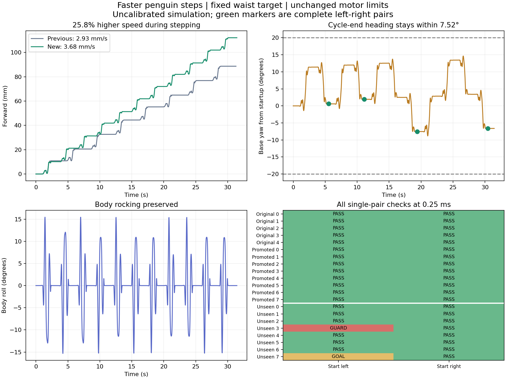

# Faster penguin steps with repaired recovery

This follow-up trains on the previous guard failures, then shortens the phase
transitions. It uses local CPU MuJoCo simulation and preserves the previous
policies, reports and videos. No physical robot, shared Ubuntu GPU or Nimbus/EY
project was used.

## Results and limits

The best four-pair nominal run advances **112.05 mm in 30.44 s of stepping**,
**3.681 mm/s**, versus the prior 2.925 mm/s: **25.8% faster**. It completes eleven
bursts with 15.26° minimum bilateral body roll, 29.77 mm peak rim-height
difference and 7.52° maximum cycle-end heading, with no falls or guard stops.
The waist target stays zero; its holding torque peaks at 0.0787 Nm and actual
angle deflects −2.63…+2.62°.

The right-starting version completes four pairs/eight bursts in 22.20 s, moves
80.96 mm at 3.647 mm/s, and stays within 0.89° at pair ends. The left-starting
version is selected for its slightly higher speed, under the user's 20° limit.
Pair size varies because feedback can request extra bursts; a pair is not a
single physical impulse.

| Check | Result |
|---|---|
| All previously seen models, both starting sides, one pair at 0.25 ms | **26/26 pass** |
| Four formerly failing walking cases repeated at 0.125 ms | **4/4 pass** |
| Fresh frozen models and noisy/delayed sensors, seed 2026111992 | **14/16 pass** |
| Four-pair nominal runs, both starting sides, 0.25 and 0.125 ms | **4/4 pass** |
| Repository tests | **105 pass** |

Unseen-3 starting left hits the unchanged 35° tilt guard; that is an incomplete
failure, not a no-fall success. Unseen-7 starting left remains physically upright
but exhausts its turn attempts, makes only 6.33 mm progress and ends 23.14° off
heading. Both failures are preserved. The full gait is therefore **not yet
robust across all new conditions**, despite repairing every previous case.
This split was not used for further tuning.

The selected left-starting run changes speed by only **0.14%** at 0.125 ms
(111.90 mm, 3.676 mm/s, 7.48° cycle-end heading). Some stress-case distances are
more timestep-sensitive even when both pass; the repaired fresh-3 left case
changes from 24.90 to 20.73 mm. No calibrated transfer accuracy is claimed.

[Watch the best real-time result](../media/simulation/faster-penguin-best-2026-11-19.mp4).



## Selected controller

The primary recipe now triggers its signed catch at 14° predicted roll using an
80 ms prediction horizon and 20 ms response delay. Its head x offset returns
starting 0.6 s after the catch over 0.4 s; requested head yaw returns over 0.4 s.
The final target still passes the same checked IK and actuator profiles.

The sequence waits for delayed body roll below 2° and filtered roll-rate below
10°/s, plus completed head-return phases. The minimum burst duration is 1.2 s,
post-catch floor is 0.6 s and quiet-state dwell is 40 ms. These settings shorten
control pauses; they do not relax the 35° tilt, joint, contact or numerical guards.
The nominal observed burst interval is about 2.76 s, down from about 3.78 s.

A half-cycle aims for a 12° heading excursion, then returns toward startup
heading, with a 2° goal tolerance and at most four bursts per half. The user's
±20° limit still applies at the end of every complete pair. The right-starting nominal run alternates after each burst; the faster
left-starting run sometimes repeats a side to meet its heading goal.

Three motion recipes are available. The ordinary fallback is selected when a
settled burst produces less than 3° signed heading progress. The newly learned
rescue launch is used only after the ordinary fallback itself produces less
than 5°, and only for the older sensor-observation regime it was trained on
(40 ms rather than nominal 20 ms). Both tests use observable feedback; the
controller never receives a model ID, ground friction, voltage or motor gain.
No base, joint, velocity or motor-state reset occurs between bursts.

The fallback launch was learned by a seeded cross-entropy search of preload,
lateral travel, frequency, pitch, forward offset, height and preload duration.
Its score required recovery on all anchor cases before rewarding the weakest
forward progress. Training includes every previously unseen failure; those
cases are now development data, not an independent holdout.

## Limits and rejected alternatives

The waist target remains exactly zero with bounded servo torque. It can deflect
and supply reaction torque; it is not welded or unpowered. The motor, mass,
friction and command-profile model is unchanged: see [sources and assumptions](MOTOR_LIMITS.md).
In particular, 5 V is still a battery-bus hypothesis, the command profile remains
10.7 rad/s / 360 rad/s² / 25 Hz, and all results are uncalibrated simulation.

Coarse 0.5 ms screens missed an instability visible at 0.25 ms. The repairs and
final qualification therefore use 0.25 ms, with a separate 0.125 ms repeat.
Earlier head return alone did not solve the failure. Gain transitions, measured
head-settling gates, scaled observation-age prediction and selecting a launch
from sensor age alone were also tested. They either slowed progress or failed
in full sequences and are not enabled in the selected configuration. Optional
implementations and every failed/incomplete report are retained.

An initial validation of age-only selection was stopped after the sequence
checks showed that selection was insufficient. Its report is explicitly
incomplete. The final controller and jobs were frozen before a new unseen
split, seed 2026111992, was evaluated.

## Reproduce

From the project directory with the pinned model and local environment:

```sh
.venv/bin/python experiments/run_penguin.py configs/penguin-faster-feedback-trained.json --side -1 --cycles 4 --seconds 36 --record experiments/generated/my-faster-penguin.json --output experiments/generated/my-faster-summary.json
.venv/bin/python experiments/render_sway.py experiments/generated/my-faster-penguin.json --output experiments/generated/my-faster-penguin.mp4 --slowdown 1 --until 31.44 --title 'FASTER PENGUIN STEPS' --diagnostics --frame-path --follow-front
.venv/bin/python -m unittest discover -s tests -v
```

Rendering reads saved physical states at 1× speed. The video omits only the long
idle tail after the final completed step; the physics report includes the full
36 s stability check. Speed comparisons use displacement through the last
completed step divided by that time, not a peak speed or shortened playback.

Main evidence: `motor-training-faster-balance-feedback-qualified-2026-11-19.json`,
`motor-training-faster-balance-finer-failures-2026-11-19.json`,
`motor-training-faster-balance-left-demo-2026-11-19.json` and
`motor-training-faster-balance-left-finer-2026-11-19.json` under
`experiments/reports/`. The artifact receipt records hashes, motor-limit audits,
software versions and preserved earlier files. The two separately initialized
right-starting recordings match every saved position/velocity frame exactly;
the selected left recording also matches its independent qualification summary.
