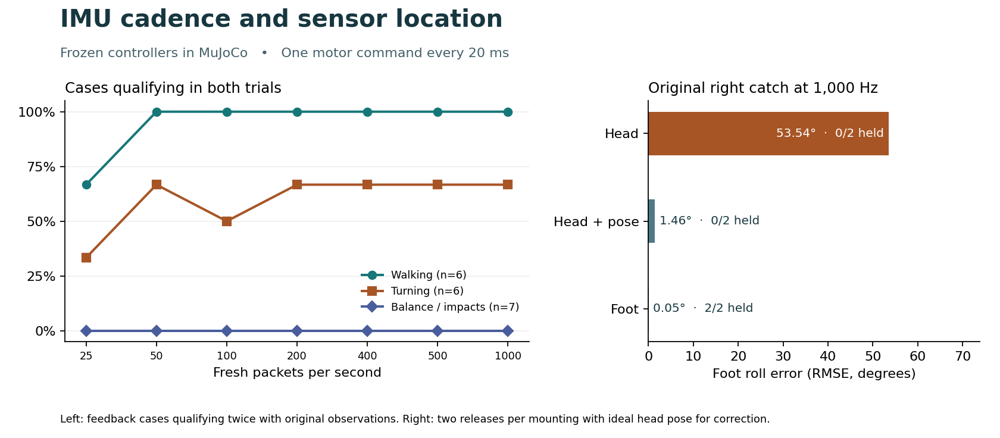

# How fast does Reachy's IMU need to be?

**50 Hz is a reasonable first hardware target for the walking and pivot controllers. No tested frequency qualified every feedback case.** The simulation compared 51 frozen skill variants and conditions in 918 matched trials and ran 110 additional placement, phase and bandwidth checks. Commands stayed at 50 Hz. Of the 42 cases with feedback, 14 qualified in both trials at 25 Hz, 18 at 50 Hz and 19 at 1,000 Hz. The nine timed motions are recorded separately. Among the 33 feedback cases that qualified twice using their original observations, 18 qualified twice at 50 Hz and 18 qualified twice at 1,000 Hz.



| Tested sensor pipeline | Feedback cases qualifying twice, out of 42 | Of the 33 qualifying twice with original observations |
|---|---:|---:|
| Original runner | 33 | 33 |
| Modeled stock 50 Hz | 18 | 18 |
| Wide 25 Hz | 14 | 14 |
| Wide 50 Hz | 18 | 18 |
| Wide 100 Hz | 17 | 17 |
| Wide 200 Hz | 18 | 18 |
| Wide 400 Hz | 18 | 18 |
| Wide 500 Hz | 19 | 18 |
| Wide 1,000 Hz | 19 | 18 |

### Which skills tolerated a slower sensor?

| Lowest rate qualifying twice at that rate and all higher tested rates | Skill variants |
|---|---|
| 25 Hz | Fast shuffle, sustained steps, distance per swing, alternating edge walking, target pivot, efficient pivot, historical heading gait and speed gait, three earlier penguin gaits, original alternating cadence, bilateral catch and catch primitive |
| 50 Hz | Edge braking, encoder-assisted edge walking and slick-floor quarter turn |
| 200 Hz | Basic gyro peg on the historical circular-foot model |
| 500 Hz | Original right CAD release on the two screening starts. It held 5/8 on follow-up |
| No consistent floor in this sweep | 23 feedback cases, including flat starts into left and right edge balance, front and back edge holds, rolling and direct ball impact recovery, the moving deck and the wide traveling circle |

The shuffle traveled at 57.3 mm/s at 25 Hz. Nominal quarter turns reached 87.8° and 92.7°. The slick-floor pair reached 88.2° and 68.7° at 25 Hz, then 90.8° and 90.6° at wide-band 50 Hz. The stock 50 Hz pipeline qualified only one slick turn. The two-minute wide circle qualified twice with original observations and at most once per IMU pipeline. The natural left and right edge holds and the rolling-impact recovery each qualified twice with original observations and zero times at every numeric rate. Maximum sensor speed alone cannot explain these losses.

[Full-resolution 51-case matrix](../media/simulation/imu-frequency.png) · [Individual distances, turns, holds, success flags and units](../experiments/reports/imu-frequency.csv)

### Does the apparent 500 Hz catch threshold hold up?

Four new packet phases were tested at the same 32.2° starting angle, with four additional releases at 32.15° or 32.25° with small signed angular velocities. The original CAD catch held both initial screening trials at 500 and 1,000 Hz. Fresh phases and slight changes in release state exposed its sensitivity.

| Original right catch | Same mechanical start, four fresh phases | Slightly changed starts | Total |
|---|---:|---:|---:|
| Stock 50 Hz | 0/4 | 0/4 | 0/8 |
| Wide 50 Hz | 0/4 | 1/4 | 1/8 |
| Wide 400 Hz | 2/4 | 2/4 | 4/8 |
| Wide 500 Hz | 2/4 | 3/4 | 5/8 |
| Wide 1,000 Hz | 2/4 | 2/4 | 4/8 |

The later right-edge policy had been refit for the stock observation path. It held 2/2 nominal screening releases with stock observations and 0/2 at every wider-band rate. At four new phases, switching the controlled front end from 145/116 Hz accelerometer/gyro bandwidth to 40/12 Hz raised the result from 0/4 to 2/4 at **both** 50 and 500 packets/s. In earlier training, feedforward replay could reproduce the exact nominal trajectory. These trials support training on measured bandwidth, latency and mechanical variation before choosing hardware solely for sample rate. [Earlier refit and replay controls](IMU_RIGHT_CATCH.md)

### What would a foot-mounted IMU buy?

In 54 paired simulations the same three controllers ran with a foot sensor, a head sensor, and a head sensor corrected using ideal synchronized head-to-foot pose. On the original CAD catch at 1,000 Hz, the mean of the two per-trial foot-roll RMSEs was **53.54° from the head, 1.46° with head-pose correction, and 0.05° from the foot**. Only the foot sensor caught both releases. The shuffle qualified with all three mounts at all three tested rates. Each controller generates its own trajectory, so the errors include the motion that followed its commands. The correction assumes exact linkage pose. Real motor position timing, mounting offsets and head accelerations still need measurement.

Start with the sensor already installed. Record supported head-only and whole-robot tilts against a camera reference, then measure distinct packet timing. A 200 Hz onboard acquisition trial would let one log be replayed at 25, 50, 100 and 200 Hz. A lightweight foot-mounted IMU is worth trialing if the head-plus-encoders estimate still misses the timing or direction of a foot-edge catch. The physical robot was unreachable at its usual hostname during this study.

### Evaluation cost

The Apple M4 CPU ran the simulations with up to nine workers in the resumed evaluation. Two nonoverlapping whole-Mac meter windows measured **6.99 Wh and 15.92 Wh**, or **22.91 Wh and $0.00687** at $0.30/kWh. The windows ran for 28.84 minutes combined at mean powers of 46.85 W and 48.03 W. A preliminary interval was interrupted before the meter wrote its receipt, leaving the full electricity cost unknown. The resumed receipt records the two rejected 1,000 Hz requests on the historical 2 ms plant. A separate three-worker rerun at 1 ms overlapped that window and replaced all 18 entries for the historical heading gait. The published matrix includes all 918 valid comparisons and the two diagnostic studies include all 110 checks. [Core power trace](../experiments/reports/compute-meter/imu-frequency-core.json) · [Resume power trace](../experiments/reports/compute-meter/imu-frequency-resume.json)

## What the stock robot can deliver

The Wireless SDK exposes a cached IMU value at 50 Hz. In the daemon one motor-loop iteration reads the BMI088 on I²C bus 4, updates a fixed-period orientation filter and publishes the result. Polling the REST endpoint faster can measure when that cache changes. The response has no device sequence number or acquisition timestamp. The physical unit was unavailable for this study. [SDK property](https://github.com/pollen-robotics/reachy_mini/blob/main/src/reachy_mini/reachy_mini.py) · [Daemon acquisition and owner of the bus](https://github.com/pollen-robotics/reachy_mini/blob/main/src/reachy_mini/daemon/backend/robot/backend.py) · [HTTP response](https://github.com/pollen-robotics/reachy_mini/blob/main/src/reachy_mini/daemon/app/routers/state.py)

Pollen places the BMI088 on the CM4 board, and its troubleshooting guide places the Pi boot switch in the head. Taken together, these point to a moving-head measurement on Wireless. Our main simulated IMU is rigidly attached to the foot, 30 mm above its origin. Confirm the production frame and its axis signs on the specific robot. With the foot supported and stationary, tilt only the head and log the IMU and measured head pose. Then hold the head fixed relative to the foot and tilt the supported assembly through a known angle. An external camera viewing markers on the foot and head gives independent ground truth in both trials. [Pollen's board description](https://github.com/pollen-robotics/reachy_mini/blob/main/docs/source/integrations/home_assistant.md) · [Pollen's board location](https://huggingface.co/docs/reachy_mini/troubleshooting)

**First hardware experiment.** With Reachy supported, record the current daemon version, BMI088 library version, gravity magnitude at rest and gyro bias. Pollen's driver update fixed a suspended accelerometer on Wireless. Use the read-only cache logger from the robot or a wired host. It reports changed six-axis vectors, arrival gaps and round-trip latency. Equal quantized readings can occur at rest, and Wi-Fi or Python scheduling can conceal frames. Use data-ready events or FIFO counts in the driver when certifying a rate. [Driver fix](https://github.com/pollen-robotics/reachy_mini/pull/1538) · [Read-only logger](../experiments/measure_imu_cache.py)

```sh
python3 experiments/measure_imu_cache.py http://reachy-mini.local:8000 imu-cache.csv --hz 150 --seconds 20
python3 experiments/measure_imu_cache.py http://reachy-mini.local:8000 head-only.csv --with-pose --hz 50 --seconds 20
```

The second command logs measured head pose, joints and waist angle alongside the six inertial channels for the supported mounting test. Each row carries host send and receive times. The daemon can cache these signals at different times within the response.

**Increasing the onboard rate.** An acquisition worker can own both sensor devices, program the output rates, drain the FIFOs or service data-ready signals, timestamp packets and integrate gyro increments at their measured intervals. The 50 Hz servo loop can consume the latest attitude and angular rate for its frame. Remove direct sensor reads from the motor loop when transferring ownership. Pollen's filter advances on each read, making simultaneous independent readers unsafe for timing. The Rust driver's `bench_imu` example is a standalone scheduling benchmark for an exclusively owned bus. Setting its loop frequency alone does not program both chip output rates. [Driver and benchmark](https://github.com/pollen-robotics/bmi088-rs) · [Current backend](https://github.com/pollen-robotics/reachy_mini/blob/main/src/reachy_mini/daemon/backend/robot/backend.py)

| Possible acquisition mode | Accelerometer ODR and filter BW | Gyroscope ODR and filter BW |
|---|---|---|
| Pinned reference settings | 100 Hz, 40 Hz | 100 Hz, 12 Hz |
| First faster bench setting | 200 Hz, 80 Hz | 200 Hz, 64 Hz (also available with 23 Hz BW) |
| Second setting | 400 Hz, 145 Hz | 400 Hz, 47 Hz |
| Asynchronous high-rate investigation | 800 or 1,600 Hz | 1,000 Hz, 116 Hz |

Bosch specifies accelerometer and gyro rates independently. For example, at 200 Hz with normal accelerometer filtering, ACC_CONF at 0x40 is 0xA9 and GYRO_BANDWIDTH at 0x10 selects mode 0x06 for 64 Hz bandwidth. A 500 Hz fused output needs resampling. At 1,000 Hz the gyro has a native setting and the accelerometer has different native rates. The simulation's wide-band packet streams isolate delivery cadence and use identical filtering at each rate. [BMI088 data sheet, sections 4.4, 5.3.10 and 5.5.6](https://www.bosch-sensortec.com/media/boschsensortec/downloads/datasheets/bst-bmi088-ds001.pdf)

Benchmark one rate at a time under normal motor-loop and camera load, with the robot supported. Log unique accel and gyro frames/s, FIFO overruns, device and host timestamps, p95/p99 age of the newest measurement at each command, and motor-loop overruns. Use a shared clock or measured clock offset for end-to-end age. Compare estimated foot roll, pitch and rate with the optical reference during head-only and whole-body motion. At deployment, replay the measured delay, quantization, noise, bias, bandwidth and sensor mounting in simulation before refitting the edge controller.

**When a backpack makes sense.** If timestamped head IMU plus measured motor positions cannot reconstruct foot motion over fast reversals, trial a small, rigidly mounted six-axis board on the nonrotating foot with a data-ready pin or FIFO and acquisition timestamps. An attachment to the head repeats the frame problem. A torso backpack also needs the waist transform when the waist moves. Measure the add-on's mass, location and cable forces, then update the balance model. A separate sensor would first buy an independent foot measurement. Suitability depends on measured latency and vibration at that mounting point.

## How the comparison works

Each case replays a frozen skill or development variant in its existing MuJoCo plant. The command clock stays at 50 Hz, and the original servo limits, delays, kinematics, contact geometry and policy parameters apply to each matched pair. `Orig.` uses the original runner's observation path. Most original runners consume simulator pose, sometimes with added delay and noise. The two right-release controllers already replay through the stock sensor model. `Stock` uses the pinned 100 Hz register model, 40 Hz accelerometer and 12 Hz gyro filtering, with a read and attitude update at 50 Hz. The stock register phase is 0 or 5 ms.

The seven numerical columns use the same ±3 g, ±500°/s quantization and causal first-order filters with bandwidths of 145 Hz for acceleration and 116 Hz for angular rate. Each fresh packet advances Madgwick once with elapsed time. Motor ticks receive the latest attitude and an average of fresh body-rate packets, holding the last rate when the interval contains none. At 25 Hz every second 20 ms command can see a fresh sample. At 1,000 Hz a command can incorporate 20 samples. Relative yaw starts at zero and is unwrapped without a compass. Each test begins with an ideal supported gravity calibration. Packet timestamps land on the next available physics integration step. A coarse plant can collapse two requested sub-step phases onto the same time. Clock phases are paired at offsets of zero and half a sample period. The wider-band and stock columns differ in filter bandwidth, publication and rate aggregation. The two 50 Hz columns are distinct experiments. Decimating the wide-band stream at 25 or 50 Hz can alias faster motion.

**Reading a cell.** Each count is out of two matched cases. The original task pass criterion applies, with the explicit screen variants below. When a matching original run succeeded and its progress is measured in distance, speed, distance per swing, rpm, signed turn or rim turns, qualification also requires at least 80% of its progress. A screen floor is the lowest tested rate that qualifies twice *and* qualifies twice at every higher tested rate. Timed commands get a separate label in the results. The four original open gaits, timed teleoperation-cadence gait, fast and rim spins with zero rate gain, side-shell stroke and deliberate fall can run their saved motion without inertial feedback. Their pass counts describe execution of that motion. The deliberate fall succeeds when it topples as intended. The two cases can be different directions, phases, plant conditions or repeats of the same deterministic motion. These counts support engineering triage. They do not estimate a population success rate.

Short screens include 24 measured cycles of the shuffle and the original 20 s large-rocking gait, one pair for the banked penguin sequence, 12 s for cadence, 20 s for continuous spins, 24 s for the basic gyro peg and the full 120 s for the wide circle. The spin screen uses a 2 rpm minimum with the original drift, sign and joint criteria, plus loaded-rim time for the rim spin. The historical deep roll uses its frozen full duration. The deep lift screen requires safe launch and one full rim winding. The prepared 40° catch must trigger and settle flat. The CAD release must stay steadily on the edge. Those are different recovery goals. The overhead trial requires a hit and a final edge hold. The side-shell test requires a 30° arc with no head contact at any time, with the torso supported on the floor. Historical open gaits use positive travel, a stable run and the 20° completed-cycle course criterion. The historical heading gait uses its 1 ms qualification timestep throughout to support 1,000 Hz. Its legacy 2 ms timestep could only represent 500 distinct acquisitions per second. Motor delay and modeled sensor noise follow each runner. A native failure can also come from a prescribed short horizon, plant mismatch or direction. Legacy guards and the legacy circular foot approximation still apply where the frozen runner used them.

The shadow scoring path retains the simulated orientation, contact forces, shell contacts, displacement and mechanical limits to measure outcomes. Some policies also use ideal relative head linkage pose or waist position as encoder proxies. Ideal mechanical initialization, synchronous clocks, a first-order filter and simplified noise make this a simulation comparison. Contact-rich results on the early circular foot geometry need separate confirmation on the CAD foot and on hardware.

## Reproducing the study

Use a project environment with Python 3.10 or 3.11, the repository's pinned simulation and IMU extras, Matplotlib for figures, and the pinned official Reachy MJCF plus mesh assets. The numerical filter is `ahrs==0.4.0`. The Mac runs used the project's Python 3.9 environment with postponed annotations for that filter. The study executes frozen policies. Its costs are evaluation costs.

```sh
python experiments/imu_frequency_study.py core
python experiments/imu_frequency_study.py extended
python experiments/imu_frequency_study.py historical
python experiments/imu_frequency_study.py openloop
python experiments/imu_placement_study.py
python experiments/check_imu_threshold.py
python experiments/report_imu_frequency.py
```

The group runners save each completed trial under `experiments/generated/frequency-study/` and resume missing conditions from those files. Use an empty output directory for a new protocol. The published matrix uses the full 20 s rocking example, 120 s wide circles and the verified side-shell stroke. The three shorter or exploratory comparisons from the preliminary run were superseded. Plot the published results directly with `python experiments/report_imu_frequency.py --replot`. [Per-trial CSV](../experiments/reports/imu-frequency.csv) · [Results including all mounting and release checks](../experiments/reports/imu-frequency.json)
