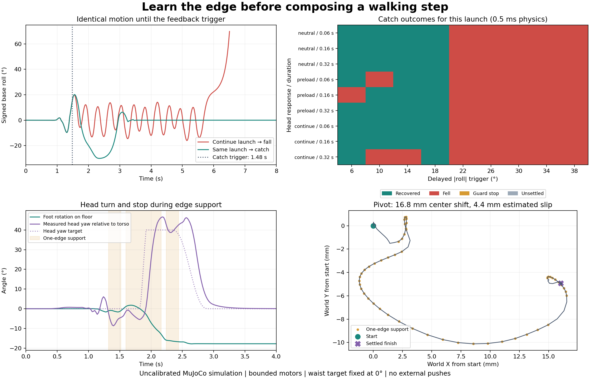

# Sideways lift, fall arrest and edge pivot curriculum

The user requested primitive skills before further forward-speed optimization:
lift one side, discover how the robot falls sideways, learn to stop the fall,
then combine head yaw/braking with edge support to pivot the base on the floor.
The waist may hold a fixed angle, but must not receive rotation commands.

These are local CPU simulation experiments with the same nominal 5 V motor model
and software target profile as the walking studies. See [MOTOR_LIMITS.md](MOTOR_LIMITS.md).
The robot is not connected. The previous walking policies remain available.

## Separate measurements and acceptance

The isolated `primitives.py` evaluator retains joint/IK, torque, rate and
closed-chain checks. Diagnostic falls may cross the walking evaluator's 35°
tilt threshold; the first crossing is recorded. A diagnostic stops at the first
nonfoot floor contact carrying more than 0.5 N, or 80° tilt. These operational
fall criteria do not establish a universal physical tipping angle. The original
walking evaluator and its 35° guard are unchanged.

Each trial starts from the same artificial neutral initialization, followed by
0.5 seconds settling in its selected waist mode. Measurement begins afterward.
No base pose/velocity writes or external pushes occur during the trial. Head
commands run at 50 Hz through the existing bounded actuator model.

- **Lift:** signed roll, peak tilt, height difference between opposite base rim
  points, unloaded-side contact force, and time supported on one edge.
- **Fall:** actual nonfoot contact/large tilt, kept separate from invalid IK,
  joint-limit, loop-closure and numerical stops. Save the motion and state history.
- **Catch:** use a 20 ms delayed simulated roll signal to trigger a bounded head
  counter-motion, then return toward neutral. Require valid full completion and
  a final 0.6-second window with tilt below 3°, angular speed below 0.2 rad/s,
  translation speed below 20 mm/s and ground support. Compare against the exact
  no-catch launch; recovering a lean that would not fall is not a demonstrated
  fall arrest. The sensing assumption is not a calibrated physical estimator.
- **Pivot:** credit rotation of the foot on the floor during edge support,
  separately from torso yaw and passive waist rotation. Report center drift and
  the velocity of the foot material point at the loaded contact. Movement of the
  contact centroid alone is not a slip measurement. A large torso turn while the
  foot stays still is not an edge pivot.

The default waist-off diagnostic explicitly zeros actuator torque every physics
step, while retaining passive joint friction/inertia. The held-waist comparison
uses the existing servo at its unchanged neutral target; it may exert torque.
It is not an ideal welded joint. These cases must not be conflated.

## Initial experiment design

Single large lateral head swings are followed by a grid of repeated pure roll /
lateral-translation swings and a randomized search over posture and timing.
Head yaw is zero during lift/tipping searches. A subsequent tipping search
maximizes sideways roll and stops seeking stronger impacts once it finds a
sideways fall. Catch search changes the response to the same launch, and pivot
search adds yaw pulse amplitude, timing and braking to a recovered lean.

The mechanical state, full-body COM, contact loads and material-point slip are
diagnostics. Control uses the simulated delayed roll angle, not contact/COM
oracle values. The API definitions used for point Jacobians, body velocity and
contact force are in the [MuJoCo reference](https://mujoco.readthedocs.io/en/stable/APIreference/APIfunctions.html).
No static COM margin is treated as proof of dynamic recoverability.

## Recorded result

[Watch the three-part real-time video](../media/simulation/primitive-curriculum-2026-11-19.mp4):
continue a launch into a sideways fall; change the head response to recover;
then add a head turn/hold/return to a different recovered launch for an edge pivot.
All three recordings use 0.25 ms physics and a constant zero waist target.
This is parameter search and feedback-triggered control, not a neural RL policy.

| Primitive | Peak sideways roll | Opposite-rim height difference | Outcome |
| --- | ---: | ---: | --- |
| Continue pumping without catch | 69.75° | 102.18 mm | First nonfoot floor contact at 6.505 s |
| Feedback recovery | 30.03° | 55.59 mm | Upright and settled; 2.82 mm final center drift |
| Head-driven edge pivot | 22.23° | 41.86 mm | −17.78° final foot yaw; upright and settled |

Rim-height difference measures geometric lift across the base; it is not flight
or absolute ground clearance. The pivot accumulates **−14.81° during 1.02 s of
one-edge support**, with **16.79 mm final center drift** and **4.37 mm estimated
material-point contact slip** during those intervals. Thus it is an edge-supported
turn with translation and some slip, not an ideal stationary, no-slip pivot.
Edge duration/yaw/slip are sampled at 50 Hz; tilt, limits and fall checks run at
every physics substep. Final yaw on aborted falls is the last full control sample;
the saved terminal pose preserves the subsequent contact event.



The fall and recovery have **75 identical recorded position/velocity states
through 1.48 s**, when the catch triggers. The delayed measurement is 11.73°,
while actual roll is already 14.79° and sampled roll rate is +152.82°/s. The
head returns toward its preload over 0.16 s, holds for 0.2 s, then returns toward
neutral. The resulting larger lean reaches about **−30°**, then settles.
Without this change the robot continues oscillating and falls several seconds
later. This demonstrates recovery from a large induced lean and prevention of
the continued launch's eventual fall. It does **not** prove that the state at
the trigger, or the later 30° state, was already irrecoverably falling.

For this launch, all tested catch thresholds **22–38°** fall at 0.5 ms. Those
thresholds trigger during the final fall, after the earlier oscillations; they
are not the same state as an early 10° trigger. Most earlier responses recover,
but action and duration matter. There is no established universal 22° tipping
limit, and no exhaustive maximum-recoverable-height claim.

## What the head turn contributes

The selected pivot requests 40° head yaw over 0.10 s when delayed |roll| reaches
18°, holds 0.40 s, then returns over 0.60 s. The target's braking fraction is
0.05; filtering, acceleration, delay and torque/speed saturation remain active.
Actual head motion overshoots the target; actual joint limits still pass.
The graph shows measured motion rather than treating the requested stroke as
perfect motor tracking.

| Matched pivot comparison, 0.25 ms | Edge-supported foot turn | Final foot turn | Recovered |
| --- | ---: | ---: | --- |
| Selected head turn/stop | −14.81° | −17.78° | Yes |
| Same recipe with yaw target zero | −10.58° | −15.30° | Yes |
| Slower 0.50 s yaw stroke | −12.55° | −16.61° | Yes |
| Same recipe, waist torque disabled | +2.46° | −6.47° | Base settles |

Adding yaw increases the magnitude of edge-supported rotation by **40.1%** over
sway alone, and the faster stroke improves it **18.0%** over the slower stroke.
This supports testing coupled sway/turn/stop. It does not isolate braking as the
sole cause: stroke duration also changes phase relative to the rocking motion.
The unpowered-waist case turns the torso −39.41° while the foot ends at −6.47°;
much of its apparent turn is passive waist motion. It fails the edge-pivot gate.

The waist target is exactly `[0, 0]` throughout the successful recordings, but
holding is active: catch/pivot peak waist torque is **0.0514/0.0533 Nm**, absolute
waist motor work **0.00182/0.00434 J**, and measured waist-joint ranges are
**−0.80…+0.75° / −2.23…+1.31°**. No waist turn is commanded. Peak head-motor
torque is at most 0.299 Nm in these recordings, below the unchanged nominal
0.416 Nm cap. The 5 V supply, mass distribution, friction, current/thermal model
and 20 ms roll estimator remain assumptions, not calibrated hardware data.

## Selection and failures retained

- Initial maps: 97 trials each with waist off and held; no falls. Isolated
  large head swings alone produced little body roll, so exploration used repeated
  roll/lateral pumping, posture and timing.
- Coarse tipping search: 204 evaluations at 1 ms. Its first fall disappears
  at 0.5/0.25 ms. That coarse result was rejected as the demonstration baseline.
- Initial catches: 198 trials at 1 ms, followed by 3 timestep baselines and
  99 late-response trials. All 99 late responses fall; early six-second screening
  also truncates some late catches and is not final qualification.
- Fine tipping: 42 evaluations at 0.5 ms; 9 distinct falls checked at 0.25 ms,
  with 4 still falling. Fine catch search evaluates 324 responses to those
  launches: 127 recover, 197 fall. Of the 12 largest recovered leans rechecked
  at 0.25 ms, 11 recover and one falls.
- First yaw search: 96 trials, 61 IK stops, 15 falls and 20 completions; none
  passes the pivot criterion. Refined timing/hold search: 82 trials, 64
  completions, 17 IK stops and one actual-joint guard stop. Twelve selected
  pivots pass at both 0.5 and 0.25 ms.

The fixed pivot gate requires a recovered/settled run, at least 0.08 s edge
support, at least 5° net turn during edge support and 5° final turn, no more
than 56 mm center drift and 15 mm sampled contact slip. Selection uses the
worse score across the two timesteps, rewarding turn and penalizing drift/slip.
The selected catch maximizes the smaller of its two peak-roll results.
Recipes were frozen **before** the following checks:

| Finer physics | No-catch launch | Recovery peak roll | Pivot final / edge turn |
| --- | --- | ---: | ---: |
| 0.5 ms | Falls | 28.41° | −17.94° / −14.89° |
| 0.25 ms (video) | Falls | 30.03° | −17.78° / −14.81° |
| 0.125 ms | Falls | 29.53° | −17.61° / −14.88° |

The 0.125 ms catch and pivot both recover. Finer integration supports the
nominal qualitative result; it does not calibrate the contact model.

**Fresh model sensitivity remains a failure.** Four seeded variations change
sliding friction (sampled from 0.55–0.90), supply (4.7–5.5 V), PID scale
(0.9–1.1), delay (0–2 frames) and mass distribution. Catch recovery is **3/4**;
the fourth falls. Pivot recovery is **3/4**, but **0/4 meet the pivot gate**:
one falls and the other three turn too little. These four trials are a small
sensitivity probe, not a reliability estimate. Mirroring the catch falls;
mirroring the pivot recovers with +29.00° final yaw but was tested only at
0.25 ms. Neither result establishes a symmetric gait.

## Reproduce

Use the project-local environment and pinned model from [CONTACT_PROBE.md](CONTACT_PROBE.md).
No hardware connection is possible through these experiment scripts. From the
repository root, choose unused output paths:

```sh
.venv/bin/python experiments/run_primitive.py configs/primitive-catch-experimental.json --record --output experiments/generated/my-catch.json
.venv/bin/python experiments/render_sway.py experiments/generated/my-catch.json --output experiments/generated/my-catch.mp4 --slowdown 1 --title 'CATCH AND RECOVER' --diagnostics --frame-path --follow-front
.venv/bin/python -m unittest discover -s tests -v
```

Replace `catch` with `fall` or `pivot` for the other recipes. `--waist off`
disables torque; `--timestep 0.000125` runs the finer check. The default is an
eight-second request, 0.25 ms physics and held-neutral waist. Deliberate fall
trials stop at the diagnostic contact/tilt event, never simulate an impact rebound.

Search scripts: `train_primitives.py`, `search_tipping.py`, `boundary_recovery.py`,
`refine_edge_pivot.py`, `qualify_primitives.py` and `finalize_primitives.py` in
`experiments/`. Each supports `--help`, rejects existing report paths and records
arguments, candidate recipes, outcomes and source hashes. Reports named
`experiments/reports/motor-training-primitives-*.json` preserve all failures.
Early source snapshots are retained locally under the ignored generated folder;
the final replay code differs from early searches only in reporting additions
and serialization, not in the selected policies' physics.

The final report records frozen recipes, source hashes, comparison checks,
fresh variations and recording hashes. Raw qpos/qvel recordings are local in
`experiments/generated/primitives-final-2026-11-19/`; the three small recipes
and the video are versioned. An independent CLI replay of the catch matches
**every saved result field, trace and trajectory**. The video renders actual
saved qpos, with a final actual terminal pose for the fall; unknown terminal
forces are not invented. Sampling into 25 fps adds less than two frames at
chapter ends. **89 tests pass**, including zero-torque waist, fixed-target
waist, recording invariance, serialization and guard classification.

To rebuild the chart, install `experiments/requirements-analysis.txt` and run
`experiments/plot_primitives.py --help` for the recording/report inputs.

## Next learning stage

Use signed roll **and roll rate** to choose when and how strongly to counteract
the fall. Train left and right separately across initial phase, friction,
voltage, delay and mass variants, with a held-out set. Build a recovery map in
angle/rate space; do not infer a single tipping angle from threshold sweeps.
Once both sides recover reliably, alternate the edge pivots with head yaw
phased to advance the unloaded side. Then restore the walking objective:
forward distance per full cycle, no falls and no more than 20° cycle-end heading.
The previous walking policies and 35° walking guard remain unchanged.
