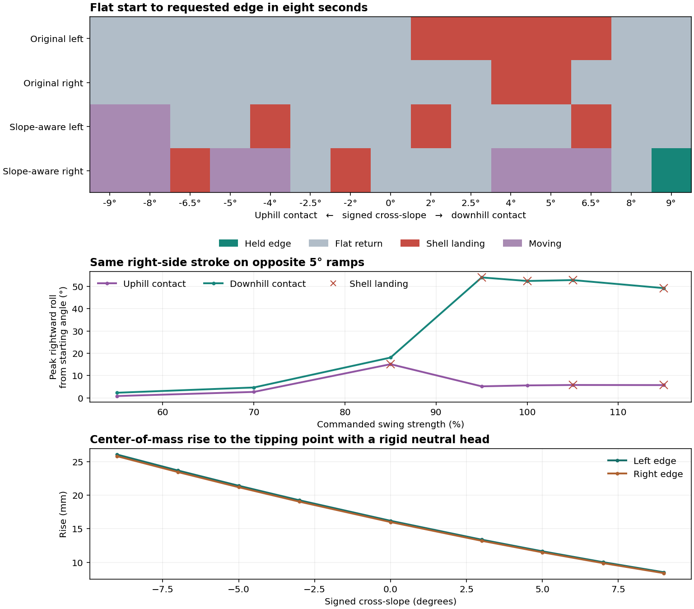

# From a flat foot to side balance on a cross-slope

Reachy starts with the whole foot resting on a sideways incline. A rightward lean is positive. On a positive bank, the left edge starts higher and the right edge starts lower. Reversing the bank swaps the roles of the two edges on the same robot.

**The frozen controller held the downhill right edge of a 9° ramp from a flat start on all four fresh sensor-noise repeats.** Each passed the five-second lean test as well. The longest continuous quiet holds ranged from 5.50 to 6.04 s in eight-second episodes. The best ended at 30.82° of body roll, with the center of pressure 51.9 mm downhill of the foot center and 1.66° of torso yaw change. The mirrored downhill left launch settled flat on all four repeats.

Across the 16 reserved launches at 2°, 4°, 6.5° and 8°, neither orientation produced a two-second hold. Six adaptive trials returned flat, five remained in motion and five landed on the shell. Two of the shell landings also crossed a modeled joint travel limit. The original level controller recorded four shell landings, while forcing the newly fitted level stroke onto all 16 conditions produced 15. Adapting the launch to measured grade helped relative to that fixed stroke, but the trained policy has a narrow working range.



[Watch the best 9° catch](../media/simulation/inclined-edge-best.mp4) · [All tested ramp grades and both orientations](../media/simulation/inclined-edge-balance.mp4) · [Frozen launch and catch settings](../configs/slope-balance.json) · [Trial measurements, simulated head motor work and compute receipts](../experiments/reports/motor-training-slope-balance.json)

The 2:05 film opens with the best fresh 9° run beside the original controller on the same start. At 0:09 it shows the original right-edge policy on opposite 6° ramps. At 0:16 it shows the common 5° stroke. From 0:24 onward it pairs uphill and downhill tests on each reserved, matched and steep ramp. The 48 filmed trajectories reproduced their recorded results and 50 Hz state-trace hashes exactly on the training Mac.

## Outcomes on both edges

Each cell is one eight-second launch with the frozen controller. “Flat” means settled on the local surface. “Moving” means the trial finished without a shell landing or a qualifying final hold and had not settled flat. The level starts on both edges returned flat. The 2.5°, 5° and 9° grades were available during fitting. The 23° downhill direction had a separate single-pulse fitting stage.

| Ramp | Left uphill | Right uphill | Left downhill | Right downhill |
|---|---|---|---|---|
| 2° | Flat | Shell | Shell | Flat |
| 2.5° | Flat | Flat | Flat | Flat |
| 4° | Shell | Moving | Flat | Moving |
| 5° | Flat | Moving | Flat | Moving |
| 6.5° | Flat | Shell | Shell | Moving |
| 8° | Moving | Moving | Flat | Flat |
| 9° | Moving | Moving | Flat | **Held** |
| 22.5° | Shell | Shell | Flat | Flat |
| 23° | Shell | Shell | Flat | Shell |
| 23.5° | Shell | Shell | Shell | Shell |

On the 14 matched level and moderate-grade starts, the adaptive policy recorded one hold, nine flat returns, four moving endpoints and zero shell landings. In 16 additional timestep or friction changes there were no holds and two shell landings. On the steep ramps there were nine shell landings in 12 launches. All 150 qualification trials passed the flat-start check, used zero commanded waist travel and completed the full eight seconds.

## What the slope changes

We rolled the neutral, rigid 1.475 kg assembly quasistatically around its CAD foot contour, following the support point as it changed. On a 5° left-high ramp the center of mass rises 11.5 mm before the downhill tipping point and 21.4 mm before the uphill tipping point. These correspond to 0.166 J and 0.310 J of gravitational potential energy. At 9° the heights are 8.4 mm and 26.1 mm. Tilt changes the distance the body has to climb, even though the peak occurs near the same angle to world vertical. The moving head changes the center of mass, and contact impacts dissipate energy. Actual head travel and work therefore require a separate measurement.

The force-weighted contact position is measured relative to the foot center both in the robot frame and along the slope. For example, a robot that spins around onto its front rim can reach a large roll angle while losing the requested side contact. The outcome chart and movie use the measured supporting edge.

The original right-edge controller illustrates this on opposite 6° ramps using the same noise seed. During the first 1.4 seconds, measured head-roll travel was 68.2° peak-to-peak downhill and 70.8° uphill. The six head motors delivered 0.858 J and 0.590 J of positive mechanical work, respectively. Downhill, the lower shell struck at 2.185 s and 66.4° of body tilt. Uphill, the body started at about −6° and its furthest rightward position was −3.0°. It settled back on the ramp. Nearly equal head travel produced very different torso motion.

At **5°**, the slope-selected right-edge launch used **79.0° of head-roll span and 1.62 J uphill**, compared with **38.1° and 1.04 J downhill** over the first 1.4 s. Maximum rightward body roll before a shell contact was 18.7° uphill and 29.6° downhill. Both completed without a shell landing and were still moving at eight seconds. With the identical level-ground stroke at 100% strength, the uphill rightward peak was 0.6° and Reachy settled flat. Downhill the peak reached 57.4° and the shell landed. On the downhill left edge the slope-selected stroke reached 30.5° at nominal strength and returned flat. Adding 5% strength sent it to 47.5° and a shell landing. These 56 strength trials change both roll and sideways travel while preserving the selected timing and feedback law.

In the six-second 9° downhill training example, the timed stroke ended at 0.94 s, the requested right edge loaded at 0.98 s and feedback began at 1.34 s. Quiet edge contact lasted 4.42 s. Final world roll was 30.81°, yaw changed by −1.37°, and the center of pressure was 51.9 mm downhill of the foot center. The minimum modeled joint clearance was 0.158 rad. The head traversed 54.8° peak-to-peak during the first 1.4 s and delivered 0.733 J of positive work. The original controller used 0.611 J over the same interval and settled flat. Seven of the 24 catch candidates for this particular training condition held the edge.

## Plant and pass conditions

- The CAD foot, lower shell and head collide with a true inclined MuJoCo plane. Gravity stays vertical. The free assembly settles under its own weight for half a second. The first ten controller samples must have less than 1° lean relative to the plane, less than 20 mm/s base speed, bilateral mean normal load above 0.5 N per side, and no edge lift. There is no assisted tilt, initial impulse or external support during the launch.
- The waist target stays at zero. The head uses the battery motor model with a hypothetical 5 V bus, derated torque and PWM, 10.7 rad/s maximum filtered joint target speed, 360 rad/s² maximum target acceleration and one frame of motor delay. The primary physics rate is 8 kHz. Shell contact is sampled each physics step, and trials continue through the landing. Contact geometry, mass distribution, motor response and battery voltage still need physical calibration.
- At 50 Hz the policy estimates the initial grade from 0.20 seconds of noisy gravity-referenced roll. The requested side and measured grade select a stroke. Some candidates also increase or decrease head-swing amplitude with the difference from the fitted grade. The handoff uses roll, roll rate and head pose. The local balance controller adjusts the head as the body moves. Simulated foot forces, contact position, future motion and exact ramp settings are available to the offline search and scorer only.
- A quiet hold requires correct side support throughout the final **two seconds** of an eight-second trial, at least 10 mm of rim separation normal to the plane, more than 0.5 N on the loaded side, less than 0.1 N on the other, and less than 30 mm/s base speed. Both roll and pitch rates must stay within 8°/s. The center of pressure must be at least 40 mm toward the requested anatomical side and, on a ramp, more than 20 mm in the requested uphill or downhill direction. Any shell landing or joint travel violation rules out a pass. The separate five-second test from the release study requires correct edge support, lean within 2° of 32.1°, pitch within 5° and roll rate within 5°/s. A flat return requires the body to settle relative to the local surface.
- Positive head work sums positive simulated actuator torque times angular speed over the six head motors. The common comparison window is the first 1.4 seconds. This quantity excludes braking work and measures mechanical energy at the joints. The Mac's electricity meter measures a separate quantity.

## Search and evaluation

The offline search tries periodic swings, timed reversals and short sequences of feasible head poses. A beam search forks the same robot and servo state at stroke boundaries. Another pass retains trajectories with angular momentum about the desired edge and penalizes motion that would carry contact around the rim. A coasting search brackets the transition between falling inward and overshooting, then tunes the feedback handoff. Candidates include a neutral head target, a head held toward the edge, and pitch damping. The final selection uses neighboring training grades. This is model-based search and local feedback control.

The frozen 9° right-downhill branch scales its timed swing to 90.7% of the fitted base amplitude. Within that grade bin it reduces the multiplier by 4.5% per additional measured degree downhill after a 0.08° deadband. The stroke ends at 0.94 s. After 1.08 s the controller can hand off to the regulator when measured outward lean exceeds 30.8°, the 35 ms projected lean remains above the threshold and estimated outward rate is at most 9°/s. In the 6.04 s example, feedback engaged at 1.48 s and the six head motors supplied 0.683 J of positive work in the first 1.4 s. The same model with independently sampled sensor noise succeeded four times at 9°. On the fresh 8° right-downhill test it reached 24.6° and settled flat.

Both edges are evaluated at level and at 2.5°, 5° and 9° with either side of the ramp raised. The original controller and the newly selected level-only controller run from the identical physical starts as the slope-aware controller. The reserved grades are 2°, 4°, 6.5° and 8°, each tested with both ramp signs and both requested edges on fresh sensor noise. Sixteen further runs vary floor friction or the integration timestep. A separate 5° experiment varies swing strength from 55% to 115%. It tests both the selected stroke and a common level-ground stroke held identical for the uphill and downhill trials on a given anatomical side. A steeper curriculum brackets the transition from an inward return to an outward fall with a single pulse on each downhill edge of a 23° ramp and checks both orientations between 22.5° and 23.5°.

## Training compute

The four measured fitting stages ran on the Apple M4 CPU with six worker processes. They covered 3,741 episode rollouts, 19 trajectory-search trees with 225,648 simulated 20 ms control frames across their branches, and four fixed-base trim calculations. Fitting took 103.32 elapsed minutes and 517.43 CPU core-minutes. Whole-Mac energy was 76.08 Wh, or $0.02282 at an illustrative $0.30/kWh. The estimate above the measured background was 49.96 Wh. The system reading includes other activity on the Mac during the fitting interval. The previous flat-ground regulators are reused. Final qualification, film rendering and the original regulator training are outside this fitting total. No GPU was used for training.

## Reproduction

Run from the project root with the pinned CAD assets and the project's simulation environment. The numerical replay checks the archived outcomes for all filmed launches. Movie rendering uses Pillow and ffmpeg, and figure generation uses Matplotlib.

```sh
.venv/bin/python experiments/archive_slope_balance.py verify
.venv/bin/python experiments/archive_slope_balance.py replay
```

To refit and re-evaluate from scratch, run these commands in order. Training power receipts in the report came from running the fitting stages under the project compute meter. The archive command expects those stage receipts in the generated directory.

```sh
.venv/bin/python experiments/slope_barrier.py
.venv/bin/python experiments/slope_balance.py search --workers 6
.venv/bin/python experiments/fit_slope_launch.py strokes
.venv/bin/python experiments/fit_slope_launch.py validate
.venv/bin/python experiments/plan_slope_strokes.py
.venv/bin/python experiments/qualify_slope_balance.py brakes
.venv/bin/python experiments/fit_coasting_catch.py
.venv/bin/python experiments/qualify_slope_balance.py freeze
.venv/bin/python experiments/qualify_slope_balance.py qualify
.venv/bin/python experiments/qualify_slope_balance.py strength
```
