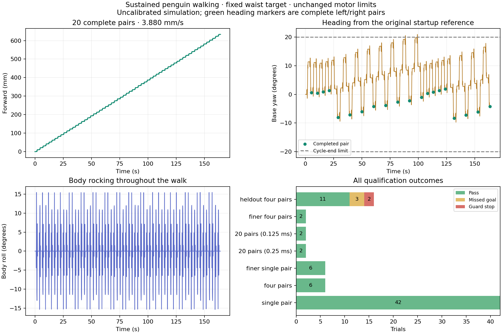

# Sustained penguin walking with repaired stress conditions

The selected controller is `configs/penguin-sustained-trained.json`. It retains
the fixed zero waist target, physical motor model, command speed/acceleration
profile, mass/contact model, checked IK and all physical failure guards.
Everything here is uncalibrated MuJoCo simulation, not a hardware demonstration.

## Sustained result

The best nominal 20-pair run advances **633.45 mm in 163.26 s of stepping**:
**3.880 mm/s**, compared with **3.690 mm/s** for the previous policy over 20
pairs from the same starting side (**5.14% faster**). It uses 62 physical
rock/pivot bursts, with no state resets, falls or guard stops. Its maximum
completed-pair heading error is **8.29°**, measured from the original startup
heading, not a new reference at each cycle.

The opposite starting direction also completes 20 pairs: 650.85 mm in 168.08 s,
3.872 mm/s and 9.00° maximum completed-pair heading error. Both directions pass
again at a 0.125 ms physics timestep; their speeds are 3.867 and 3.865 mm/s.
The largest speed change is **0.33%**. Fine integration can change which extra
burst feedback requests, so distance and duration are not individually identical.

In the selected left-starting recording, minimum bilateral body roll is 15.26°,
peak roll is 15.46°, peak body tilt is 17.53°, and peak opposite-rim height
difference is 29.78 mm. This is edge-supported rocking; no flight claim is made.
The waist target remains zero while its measured angle deflects −2.63…+2.62°.
Holding torque peaks at 0.0787 Nm, with 0.383 J of absolute waist motor work
over the full 200 s trial. A held target is not a welded or unpowered waist.

[Best real-time video](../media/simulation/sustained-penguin-best-2026-11-20.mp4).



## Qualification

| Check | Result |
|---|---|
| Previously seen conditions, both starting sides, one pair | 42/42 pass |
| Six difficult conditions, four consecutive pairs | 6/6 pass |
| Six difficult single-pair checks at 0.125 ms | 6/6 pass |
| Two repaired repeated-walk conditions at 0.125 ms | 2/2 pass |
| Nominal 20-pair runs, both sides, 0.25 and 0.125 ms | 4/4 pass |
| New frozen conditions, four pairs, seed 2026112007 | 11/16 pass |
| Repository tests | 110 pass |

The fresh split was generated after freezing the final policy and is not used
for selection. Its full results, including any failed or incomplete trial, are
retained in `motor-training-sustained-fresh-final-2026-11-20.json`. Heldout-3
hits the 35° tilt guard from both starting sides. Heldout-6 starting left does
not finish its turn goal. Heldout-1 and heldout-7 starting right stay upright
and complete four pairs, but their mean pair distances are only 10.68 and
11.69 mm, below the unchanged 15 mm gate. **Robust walking across all new
conditions is not achieved.** These were longer tests on a different split
than the previous 14/16 single-pair result; those pass rates are not directly
comparable. No tuning followed the new split.

There is an explicit distinction between direct rollouts and reused checks
with an identical control path. The final controller change only enlarges the
steering tolerance on a progressing final retry. Previously successful halves
already passed the tighter test, so they take exactly the same branch under
the selected policy. Their recorded results remain applicable without a new
physics run. The two previously unsuccessful repeated-walk paths were rerun
at both timesteps, and the finer single-pair case with a 3.8° residual was also
rerun. `build_sustained_qualification.py` verifies the policy
difference and the successful paths, and records the source of every check.
The selected 20-pair video is a fresh rollout of the final policy; its recorded
physical states are compared with the earlier nominal rollout separately.

## What was learned

The primary catch now uses a 10° signed predicted-roll threshold and a 40 ms
prediction horizon, replacing 14° and 80 ms. This repairs the previously tipping
condition without changing actuator limits. The requested head-yaw return is
shortened from 0.40 to 0.25 s, with a requested hold of 0.10 s. Roll/rate and
phase-completion checks still determine when a new burst can start.

A seeded cross-entropy search retunes the rescue launch's preload, lateral
travel, pitch, forward/vertical offset, pumping frequency and phase. Candidate
`g0-9` (seed 2026112003) passes both the newly exposed weak-turn condition and
the earlier delayed-sensor case. Selection still uses observed heading progress
and known sensor age, not model identity, friction, voltage or motor gain.

Ordinary half-step steering keeps its 2° target tolerance. On the fourth and
final retry only, a burst making positive observed progress may finish within
6° of its target. This prevents an otherwise upright, progressing walk from
stopping over a small residual steering error. The **20° completed-cycle limit**,
15 mm mean pair-distance gate, positive progress for every pair, bilateral
rocking criterion, and every physical guard remain unchanged. The nominal
20-pair runs use at most two bursts per half and never need this exception.

Rejected experiments are preserved: alternate catch thresholds, emergency
neutral returns, gain transitions, sensor-age scaling, separate fallback memory
for each side, extra joint-command margin, and alternative rescue motions.
An 8° half-step target caused short steps in twelve known cases; the selected
policy restores the 12° target. That candidate also exposed a joint-limit stop
in a longer trial. No failed candidate is counted as a selected-policy success.

## Reproduction and limitations

```sh
.venv/bin/python experiments/run_penguin.py configs/penguin-sustained-trained.json --side -1 --cycles 20 --seconds 200 --record experiments/generated/my-sustained-walk.json --output experiments/generated/my-sustained-summary.json
.venv/bin/python experiments/render_sway.py experiments/generated/my-sustained-walk.json --output experiments/generated/my-sustained-walk.mp4 --slowdown 1 --until 164.26 --title 'SUSTAINED PENGUIN WALK' --diagnostics --frame-path --follow-front
.venv/bin/python -m unittest discover -s tests -v
```

The video renders saved physical states at 1× and removes only the final idle
tail, showing one second of rest after the last step. The full nominal physics
trial lasts 200 s. Training/stress jobs may stop after one second of physical
post-controller settling; an integration test verifies that this does not change
any frame before stopping. The bounded simulation horizon is now 600 s and the
controller permits up to 30 pairs, enabling long trials without resetting state.

The software target profile remains 10.7 rad/s, 360 rad/s² and 25 Hz; the control
loop is 50 Hz. Motor torque/speed envelopes, total mass of 1.475 kg, battery-bus
hypothesis and all underlying assumptions are unchanged; see [motor sources and
limits](MOTOR_LIMITS.md). Voltage, actual servo dynamics, sensors and floor contact
still need physical calibration. There is no thermal model, so long simulation
success is not a motor endurance or hardware-readiness claim.

Final evidence is under `experiments/reports/motor-training-sustained-*`:
`qualification-final`, `tolerance6-repair`, `long-final`, `selected-demo`,
`fresh-final`, and `artifact-receipt`. Earlier failed screens remain alongside
these records. No shared GPU, physical robot, Nimbus or EY project was used.
