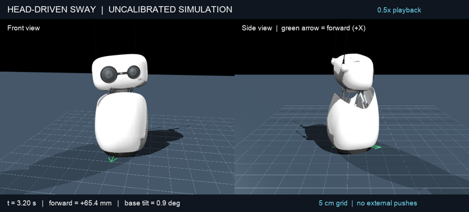

# Head-driven rocking and forward travel in MuJoCo

**Result:** a scripted roll/yaw pattern produces alternating base-edge support
and forward motion in the uncalibrated model. A 30-cycle run advances **158.4 mm
in 6.60 simulated seconds**, with 6.3 mm net lateral drift. This is simulation
evidence of a candidate mechanism, not a trained policy or hardware result.



[Full simulation video, half-speed playback](../media/simulation/sway-forward-2026-11-18.mp4).
Both views are fixed cameras. Grid spacing is 5 cm; the green arrow marks +X
forward. Metrics exclude startup and two warm-up cycles. The video renders saved
MuJoCo states rather than animating or moving the base by hand.

## Controller and model

- Uses official `reachy-mini-rust-kinematics==1.0.3` with the pinned model's
  `kinematics_data.json`. Static pose verification measured 0.109 mm position
  error and 0.127 degrees orientation error for a combined roll/pitch/yaw target.
- Input poses use the moving foot frame, with a nominal head height of 177 mm.
  Model optical-camera forward confirms the +X forward convention. Only the
  seven body/head servo controls are written; commanded body yaw stays zero.
- Selected **requested** waveform: 40-degree roll sine, 30-degree yaw sine
  leading by 90 degrees, zero commanded pitch/translation. Frequency rounds to
  4.545 Hz so a whole cycle fits the 50 Hz command period (11 samples/cycle).
  These are exploratory inputs, not recovered commands from the video.
- The motors cannot follow those requested amplitudes. In the 12-cycle run,
  measured head roll is approximately -8.6 to +6.1 degrees; yaw approximately
  -11.0 to +10.6 degrees. Peak orientation tracking error is about 45 degrees,
  and at least one motor is near its torque cap throughout measurement. This
  saturated regime needs identification before any transfer attempt.
- Foot collider is a 56 mm-radius cylindrical approximation informed by the
  CAD underside's approximately ±55.953 mm lateral extent. The original 75 mm
  proxy was wider than the mesh's actual bottom. The mesh itself has a clipped/
  asymmetric outline, so the new cylinder is still an approximation.
- The candidate uses **an assumed 1.2 Nm motor cap**, rather than the earlier
  assumed 0.6 Nm cap. Neither value has been verified on the user's robot.
  Mass/inertia, damping, contact compliance, friction, delay and speed limits
  remain uncalibrated. No cable is represented.

## Measurements and checks

All 170 study results, including four invalid outcomes, are in
`experiments/reports/sway-study-2026-11-18.json`: 135 initial sweep trials,
18 sensitivity trials and 17 controls/extended trials. This is a deterministic
parameter sweep, not RL or independent physical repetitions.

Twelve measured cycles take 2.64 simulated seconds:

| Pattern / condition | Forward travel | Lateral travel | Interpretation |
|---|---:|---:|---|
| No head motion, 2 ms | <0.001 mm | <0.001 mm | Stationary baseline |
| Roll only, 2 ms | 10.4 mm | -11.5 mm | Some drift; much less forward travel |
| Coupled roll/yaw, 2 ms | 61.1 mm | +11.5 mm | Candidate |
| Same coupled motion, 1 ms | 47.8 mm | -5.3 mm | Forward sign survives; distance and steering differ |
| Reversed yaw phase, 2 ms | -27.0 mm | +2.4 mm | Backward travel |
| Reversed yaw phase, 1 ms | -27.1 mm | +3.5 mm | Reversal persists |
| Candidate with 0.6 Nm cap, 2 ms | 0.83 mm | +0.23 mm | Almost no base rocking |
| Candidate with 0.9 Nm cap, 2 ms | 4.91 mm | +0.90 mm | Weak motion |

The candidate advances under sliding-friction coefficients 0.4, 0.7 and 1.0 at
both 1 ms and 2 ms. It is **not robust directional control**: at friction 0.4,
lateral travel reaches about 69 mm, exceeding forward travel. The larger 75 mm
foot proxy reduces progress to about 6.9 mm. A 2.4 Nm / 3 Hz candidate that looked
successful at 2 ms exceeds the 35-degree tilt limit at 1 ms, so it is rejected.

The 30-cycle candidate alternately unloads the left and right half of the foot
for approximately 49.8% and 50.1% of measured steps. At least one foot/floor
contact remains throughout. Peak base tilt is 6.43 degrees; opposite-side rim
clearance reaches about 10.9 mm. Maximum loop-closure residual is 0.097 mm.
There are no external pushes, direct base-position updates, solver warnings or
non-foot floor contacts during this accepted run. Initialization is artificial
and excluded from travel. An unloaded side means its summed normal force is
below 0.1 N while the other side exceeds 0.1 N; it is a simulation diagnostic.

The combined motion, alternating support, reversal with yaw phase and persistent
travel after warm-up support a penguin-like rocking mechanism **within this
model**. Contact slip may contribute. These checks do not identify the actual
robot's physics or prove precise timestep convergence.

## Reproduce

Use the repository's virtual environment and pinned upstream checkout from
[CONTACT_PROBE.md](CONTACT_PROBE.md). Do not install a daemon or connect a robot.

```sh
.venv/bin/python -m pip install -e '.[capture,sim]'
.venv/bin/python -m reachy_locomotion.sway --config configs/sway-cad-proxy.json --gait configs/sway-candidate.json --cycles 30 --output experiments/generated/my-sway.json
.venv/bin/python experiments/sway_study.py --stage all --output experiments/reports/sway-study-new.json
.venv/bin/python -m unittest discover -s tests -v
```

Reports refuse overwriting. `--stage controls` runs only the shorter control
suite. For video (requires `ffmpeg`, Pillow and graphics access):

```sh
.venv/bin/python experiments/render_sway.py experiments/generated/my-sway.json --output media/simulation/my-sway.mp4
```

The renderer also saves a GIF preview and PNG. Local macOS rendering required
graphics access outside the filesystem sandbox; physics tests run headlessly on
CPU. No shared Ubuntu/GPU job, physical robot or network controller was used.

## Next experiment

Fit realistic motor speed/torque/delay and the underside contact shape, then
search slower trajectories that achieve their requested head motion with less
saturation and lower lateral drift. Compare against new recorded teleoperation
targets/IMU/foot pose before designing an imitation or residual RL controller.

Primary implementation references: [pinned analytical IK wrapper](https://github.com/pollen-robotics/reachy_mini/blob/a9a2a42adcc1abc7d9c90d390889bbebf930c96c/src/reachy_mini/kinematics/analytical_kinematics.py),
[MuJoCo 3.3.7 Python API](https://mujoco.readthedocs.io/en/3.3.7/python.html),
[Reachy coordinate concepts](https://huggingface.co/docs/reachy_mini/en/SDK/core-concept).
